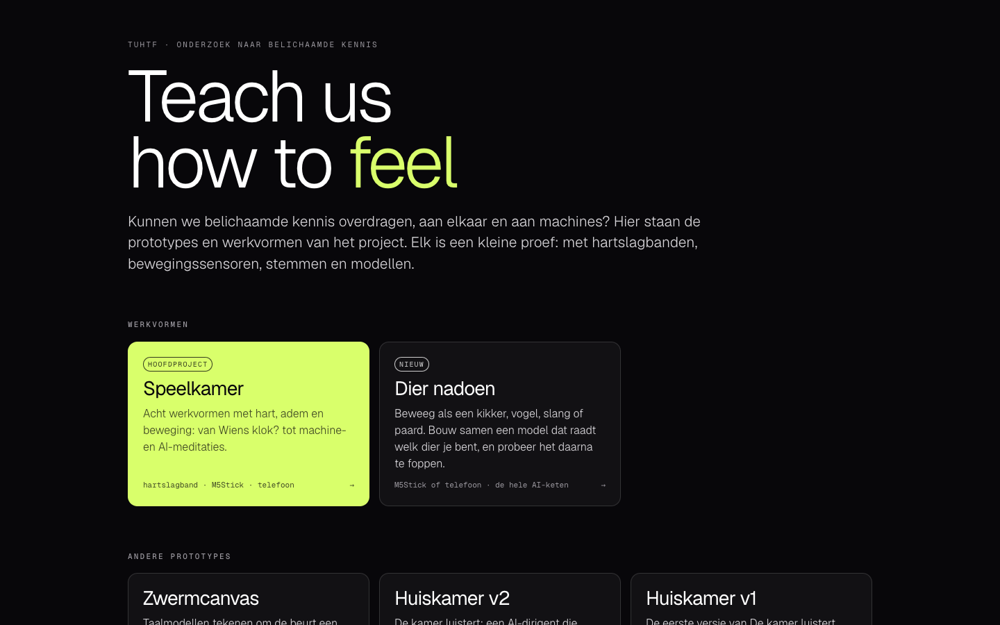
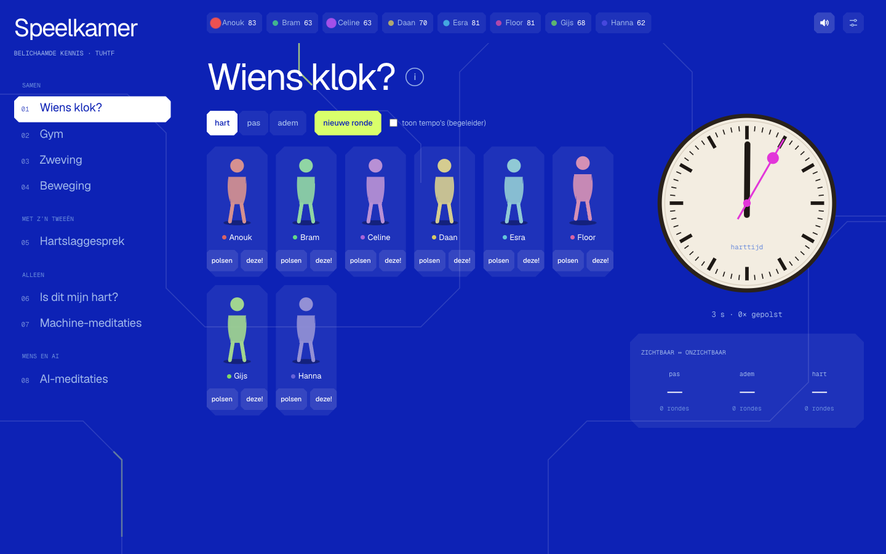
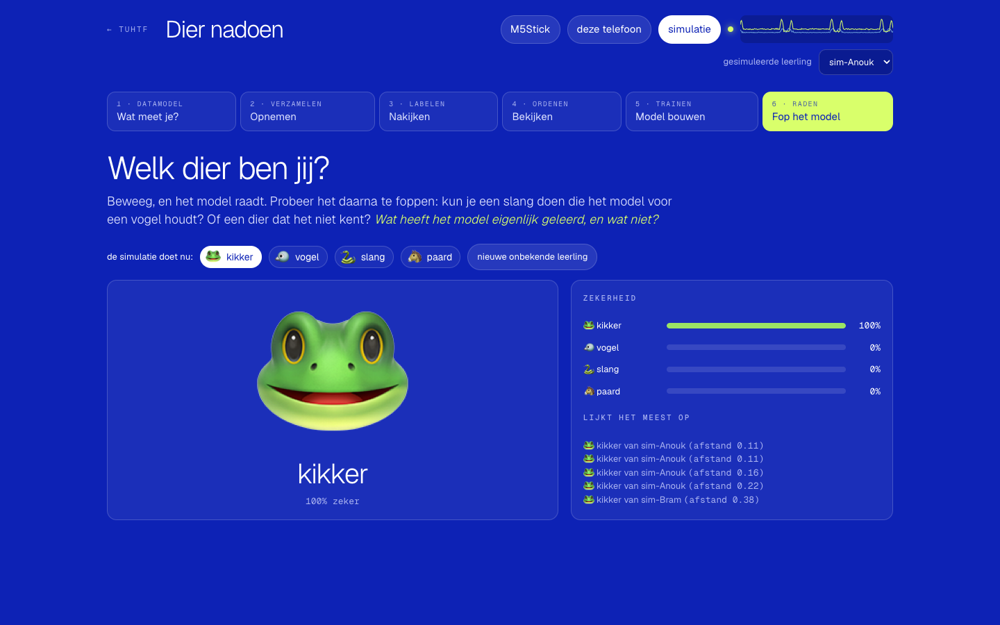

# TUHTF: Teach us how to feel

*Artistiek ontwerpend onderzoek naar belichaamde kennis, tussen mensen en machines. December 2025 tot juni 2027.*

Een groot deel van wat we weten, weten we met ons lijf. Wie die kennis wil delen, moet haar eerst uit het lichaam halen (in woorden, gebaren, getallen) en daarna weer laten landen in een ander lichaam. Of in iets zonder lichaam. TUHTF onderzoekt wat er bij die vertaling verloren gaat, wat er stuurt, en wat we ervan leren over ons eigen voelen.

Deze repo bevat de prototypes. Een landingspagina linkt naar alle subprojecten:

- **[Speelkamer](#de-speelkamer)** (`/app.html#speelkamer`): een webapp met korte werkvormen waarin deelnemers hartslagbanden en bewegingssensoren dragen, en hun lichaamssignalen horen, zien en met elkaar delen.
- **[Dier nadoen](docs/werkvormen/09-dier-nadoen.md)** (`/dier-nadoen/`): beweeg als een dier en bouw samen een model dat raadt welk dier je bent. Deelnemers doorlopen de hele AI-keten.
- **[Andere prototypes](docs/andere-prototypes.md):** zwermcanvas, huiskamer v1 en v2, tijdatlas.






## De Speelkamer

| | Werkvorm | | Kernvraag |
|---|---|---|---|
| **met de groep** | [Wiens klok?](docs/werkvormen/01-wiens-klok.md) | Een klok tikt iemands hart, pas of adem. Van wie? | Wat is zichtbaar aan een lichaam, en wat niet? |
| | [Gym](docs/werkvormen/02-gym.md) | Koekoek en Herstelslag: stilstaan als de wachter kijkt, je hart omlaag krijgen op commando. | Kun je je lichaam sturen terwijl een machine kijkt? |
| | [Zweving](docs/werkvormen/03-zweving.md) | Ieder hart een toon. Samen, met vier, of juist uit elkaar. | Kun je je afstemmen op een ander hart? |
| | [Beweging](docs/werkvormen/04-beweging.md) | Sensor & kalibratie, stil-wedstrijd, ademzwerm, wie leidt? | Wat blijft er over van een lichaam als het data wordt? Wie volgt wie? |
| **met z'n tweeën** | [Hartslaggesprek](docs/werkvormen/05-hartslaggesprek.md) | Zonder woorden, met elkaars hart in je oor. | Gaan harten meebewegen als ze elkaar horen? |
| **alleen** | [Is dit mijn hart?](docs/werkvormen/06-is-dit-mijn-hart.md) | Tellen, herkennen, raden. | Hoe goed voel je jezelf? |
| | [Machine-meditaties](docs/werkvormen/07-machine-meditaties.md) | Lummelen bij apparaten die op jouw lichaam lopen. | Kunnen machines lummelen, en wij terwijl zij werken? |
| **mens en ai** | [AI-meditaties](docs/werkvormen/08-ai-meditaties.md) | Een stem zonder lichaam die naar het jouwe luistert. | Kan iets zonder lichaam ons leren voelen? |

Alles werkt ook zonder sensoren: de app vult aan met gesimuleerde lichamen.

## Dier nadoen

[Dier nadoen](docs/werkvormen/09-dier-nadoen.md) is een los subproject in [`dier-nadoen/`](dier-nadoen/). Deelnemers dragen een M5Stick of gebruiken hun telefoon, en doen een kikker, vogel, slang of paard na. In zes stappen bouwen ze samen een model: datamodel, verzamelen, labelen, ordenen, trainen en raden. Daarna proberen ze het model te foppen. De kernvraag: kan een mens een dier echt nadoen, en wat leert een machine daarvan?



## Documentatie

- **[Over TUHTF](docs/over-tuhtf.md):** de onderzoeksvraag, zes deelvragen, lummelen, de AI-keten.
- **[Handleiding voor docenten en onderzoekers](docs/handleiding-docenten.md):** voorbereiden, opstelling, voorbeeldprogramma's, zorgvuldig omgaan met data, problemen oplossen.
- **[Werkvormen](docs/werkvormen/)**, inclusief [Dier nadoen](docs/werkvormen/09-dier-nadoen.md): per werkvorm de thematische inbedding, een artistiek statement, stappen, varianten, nabespreekvragen en aanwijzingen voor onderzoek.
- **[Hardware](docs/hardware.md):** hartslagbanden, M5StickC Plus2, telefoon als zender, draagplekken.
- **[Techniek](docs/techniek.md):** code, structuur, stemmen opnieuw maken, een werkvorm toevoegen.
- **[Andere prototypes](docs/andere-prototypes.md):** zwermcanvas, huiskamer, tijdatlas.

## Snel starten

```bash
npm install
npm run dev
```

Open daarna http://localhost:5173 in Chrome of Edge. Dat is de landingspagina met alle subprojecten. Oude links zoals `…/#speelkamer` worden doorgestuurd naar `/app.html#speelkamer`. Voor de zwermcanvas en de huiskamer-prototypes heb je API-sleutels nodig: kopieer `.env.example` naar `.env`. Zie [techniek](docs/techniek.md).
