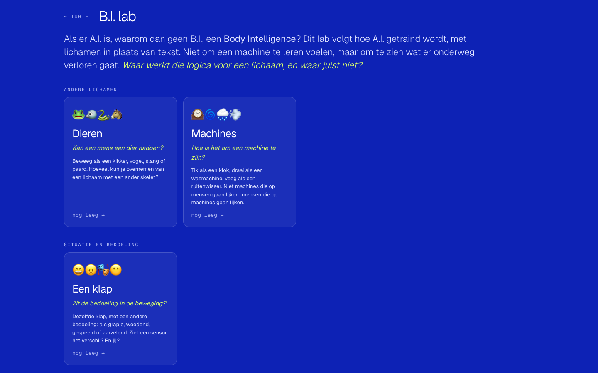

# B.I. · Body Intelligence

*Als er A.I. is, waarom dan geen B.I.?*

B.I. is een onderzoekslijn binnen TUHTF, samen met choreograaf Katja Heitmann en de B.I.-groep. Stel dat we een model van belichaamde kennis kunnen maken, een *Body Intelligence*. Hoe zou dat eruitzien, hoe zou het kunnen werken, en hoe zou het moeten zijn?

Het doel is niet om een A.I. of taalmodel lichamelijke intelligentie te leren. Volgens de paradox van Moravec is dat precies wat machines het slechtst kunnen. We gebruiken de manier waarop A.I. wordt ontwikkeld en getraind als **inspiratiemodel**: stap voor stap, met dezelfde vragen. Wat leggen we vast? Hoe knippen we het op? Wie labelt? Wat is "goed"? Juist waar die logica níét werkt voor een lichaam, zien we welke kennis we gewoonlijk wegreduceren, over het hoofd zien of moeilijk onder woorden krijgen.

## In deze map

| | |
|---|---|
| **[B.I. ontwikkelen](bi-ontwikkelen.md)** | Denkstuk: de A.I.-keten als inspiratiemodel, wat we kunnen vastleggen (met en zonder sensoren), waar de logica schuurt, en een mogelijke route naar 8 december en de presentatie bij MU. Met vragen voor het overleg. |
| **[Ingangen](ingangen.md)** | Bewegingen en gedragingen die tegelijk lichamelijk, emotioneel, situationeel en metaforisch zijn. Van de klap in het gezicht en wie leidt? tot opstaan, troosten en een klok nadoen. |
| **[Andere lichamen](andere-lichamen.md)** | De eerste werkvorm in het B.I.-lab: doe een dier, een machine of een klap na, en bouw samen een model dat raadt wat je doet. |
| **[Logboek](logboek.md)** | Het creatieve onderzoeksproces: waar lopen we tegenaan, welke keuzes maken we samen? |

## Het B.I.-lab

Het lab staat op `…/body-intelligence/`, of kies **B.I. lab** op de landingspagina. Het is voor B.I. wat het Lummellab is voor hart en adem: een plek om snel proefjes te doen, met echte lichamen en echte sensoren.

Elke **set** is een vraag aan het lichaam, en elke set doorloopt de A.I.-keten: datamodel, verzamelen, labelen, ordenen, trainen en raden.

- **Andere lichamen.** *Dieren*: kan een mens een dier nadoen? *Machines*: hoe is het om een machine te zijn?
- **Situatie en bedoeling.** *Een klap*: zit de bedoeling in de beweging?
- **Zelf bedenken.** Een eigen set, met zelfgekozen categorieën.

Na elke opname vraagt het lab hoe het voelde, in een woord en op een schaal van gespeeld tot echt. Zo komt naast de sensordata ook iets in de dataset wat geen sensor meet.

Onderaan het lab staan **voorstellen** voor nieuwe proeven: Fragmenten, Doorgeven, Beleving en verschijning, en Lichaam als prompt. Die zijn nog niet gebouwd. Ze worden uitgelegd in [B.I. ontwikkelen](bi-ontwikkelen.md#het-lab-als-onderzoeksplatform).
