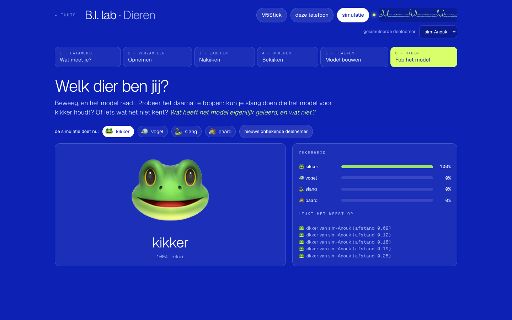
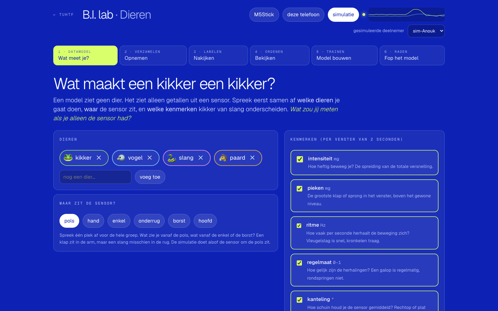
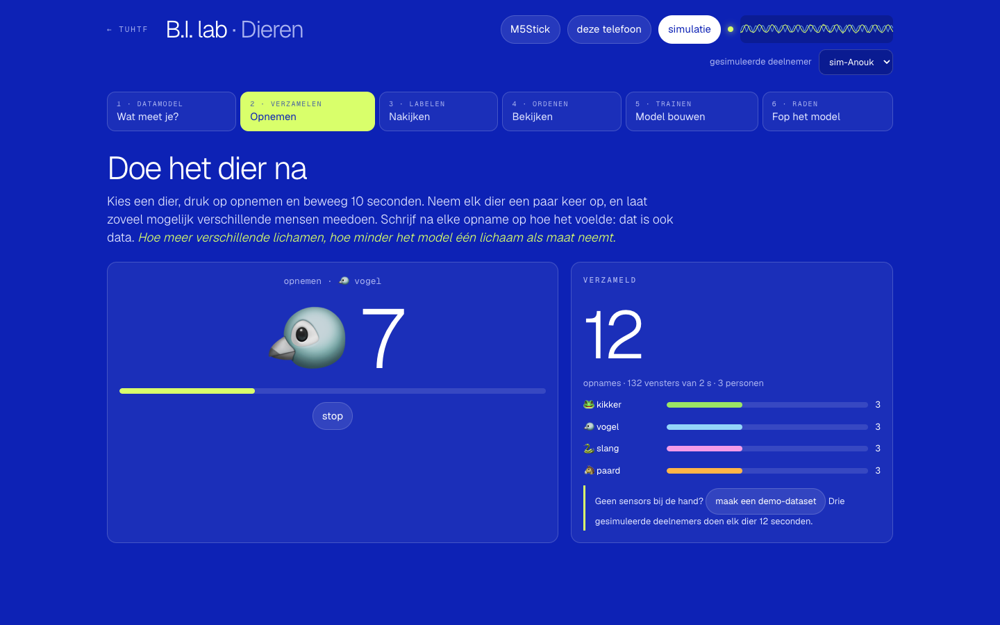
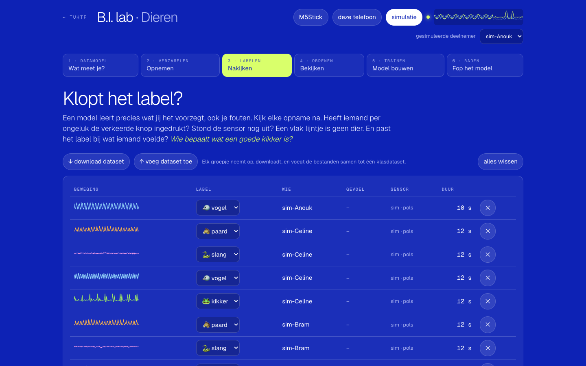
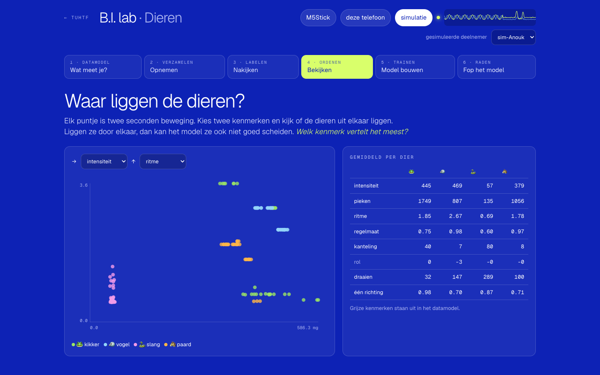
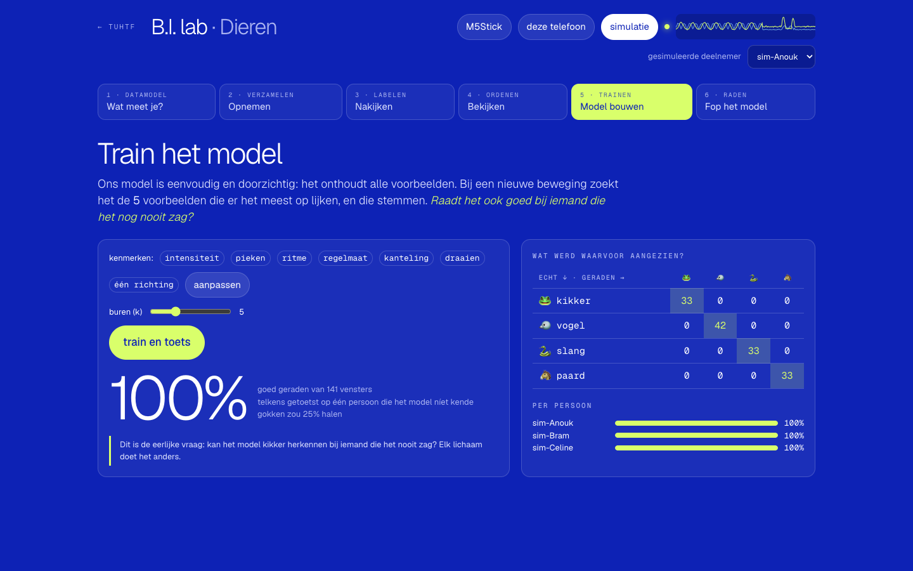

# Andere lichamen (B.I.-lab)

*Doe een dier, een machine of een klap na. Bouw samen een model dat raadt wat je doet. Probeer het daarna te foppen.*

**Groep** 4 tot 30, in groepjes van 3 à 4 · **Duur** 60 tot 120 minuten · **Sensoren** een M5Stick per groepje, of de telefoon van een deelnemer; zonder sensoren werkt de simulatie · **Deelvraag** [2](../over-tuhtf.md#zes-deelvragen) en [3](../over-tuhtf.md#zes-deelvragen), en de hele [AI-keten](../over-tuhtf.md#de-ai-keten-als-werkmateriaal)

Dit is de eerste werkvorm in het [B.I.-lab](README.md), een los subproject buiten het Lummellab: `…/body-intelligence/`. Je vindt het ook via de landingspagina. Het oude adres `…/dier-nadoen/` stuurt door.

*Stap 6: de gesimuleerde deelnemer doet een kikker na, en het model weet het zeker. Rechts staan de voorbeelden waar de beweging het meest op lijkt.*

## Sets

Elke set is een andere vraag aan het lichaam, met dezelfde zes stappen.

| Set | Vraag | Categorieën |
|---|---|---|
| **Dieren** | Kan een mens een dier nadoen? | kikker, vogel, slang, paard |
| **Machines** | Hoe is het om een machine te zijn? | klok, wasmachine, ruitenwisser, ventilator |
| **Een klap** | Zit de bedoeling in de beweging? | grapje, woedend, gespeeld, aarzelend |
| **Eigen set** | Wat wil jij een model leren? | zelf kiezen, bijvoorbeeld leiden en volgen, of een hand geven op vier manieren (zie [ingangen](ingangen.md)) |

Elke set bewaart zijn eigen opnames. Categorieën kun je per set toevoegen en weghalen. Voor alle twaalf voorgestelde categorieën is er een simulatie. Bij zelfbedachte categorieën maakt de simulatie een willekeurige, maar per naam vaste beweging.

**Machines.** Niet machines die op mensen gaan lijken, maar mensen die op machines gaan lijken. Tik als een klok met je arm als slinger, draai als een trommel, veeg als een ruitenwisser, zwaai en zoem als een ventilator. Hoe regelmatig kan een mens worden? En hoe voelt dat? Zie ook [andere intelligenties](bi-ontwikkelen.md#andere-intelligenties).

**Een klap.** Dezelfde beweging met vier bedoelingen. Sla nooit op een lichaam: sla in de lucht, op een kussen of op een opgehouden hand. In de simulatie haalt het model "grapje" en "gespeeld" vaak door elkaar. Zit het verschil in de beweging, of alleen in de situatie?

## Thematische inbedding

*Deze tekst gaat over de set dieren. Voor machines en de klap: zie hierboven en [B.I. ontwikkelen](bi-ontwikkelen.md).*

Een kind weet hoe een kikker beweegt. Het hurkt, zet af en landt. Niemand heeft het dat uitgelegd. Het is belichaamde kennis, en die is opgedaan door te kijken naar een ander lichaam, met een ander skelet, andere spieren en een ander zwaartepunt. Toch kunnen we het nadoen. Of denken we dat alleen?

Dieren nadoen gaat over twee vertalingen tegelijk. De eerste is van dier naar mens: hoeveel kun je van een slang overnemen als je geen slang bent? Dat is het membraan van [deelvraag 3](../over-tuhtf.md#zes-deelvragen), maar dan tussen soorten. De tweede is van mens naar machine: wat blijft er van jouw slang over als hij door een sensor gaat? Dat is [deelvraag 2](../over-tuhtf.md#zes-deelvragen). Wat de sensor van een slang ziet, is een paar getallen per seconde: hoe hard, hoe snel, hoe schuin, hoeveel draaiing.

Het is ook de enige werkvorm waarin deelnemers **de hele AI-keten** zelf doorlopen. Ze bedenken een datamodel, verzamelen data, labelen, ordenen, trainen een model en spelen ermee. Elke stap is een keuze die het model vormt. Juist het foppen aan het eind laat zien wat het model echt heeft geleerd. Dat is meestal iets anders dan "kikker".

## Artistiek statement

Een klaslokaal vol mensen die springen, fladderen, kronkelen en galopperen, met een kastje om de pols. Het is een beetje belachelijk, en dat mag. Wie een dier nadoet, laat zijn eigen lichaam even los.

Het werk stelt een eenvoudige vraag met een ongemakkelijk antwoord: wie bepaalt wat een goede kikker is? Het model leert de kikker van deze groep, op deze dag, met deze sensor op deze plek. Doet iemand een kikker die anders is, dan bestaat die kikker voor het model niet. Zo maakt het werk voelbaar hoe een model ontstaat: niet uit de wereld, maar uit de keuzes en lichamen van de mensen die het voeden.

## De app: zes stappen

De app volgt de AI-keten. Bovenin kies je de bron. **M5Stick** gebruikt het MQTT-kanaal van het Lummellab: vul dezelfde kanaalcode in als in de stick. **Deze telefoon** gebruikt de bewegingssensor van het apparaat zelf, en werkt alleen via https. **Simulatie** is een gesimuleerde deelnemer met de sensor om de pols. Rechtsboven loopt het signaal live mee: groen is de versnelling, blauw de draaiing.

### 1 · Datamodel: wat meet je?

Spreek samen drie dingen af.
- **Welke dieren.** Standaard kikker, vogel, slang en paard, maar je kunt dieren toevoegen en weghalen.
- **Waar de sensor zit:** pols, hand, enkel, onderrug, borst of hoofd. Kies één plek voor de hele groep.
- **Welke kenmerken het model mag gebruiken.** Elk kenmerk wordt berekend over twee seconden beweging: intensiteit, pieken, ritme, regelmaat, kanteling, rol, draaien en één richting. Elk kenmerk heeft een uitleg in gewone taal.

Begin zonder app. Laat groepjes eerst op papier bedenken wat een kikker van een slang onderscheidt, als je alleen een bewegingssensor hebt. Vergelijk dat daarna met de kenmerken in de app.

### 2 · Verzamelen: opnemen

*Een opname loopt: drie seconden aftellen, dan tien seconden vogel.*

Kies een dier, vul in wie het doet en druk op opnemen. Na drie seconden aftellen neemt de app 10 seconden op (instelbaar van 5 tot 30). Neem elk dier een paar keer op, met zoveel mogelijk verschillende mensen. Een opname van 10 seconden levert negen voorbeelden van twee seconden op.

Na elke opname vraagt het lab **hoe het voelde**: een woord of zin, en een schuif van gespeeld naar echt. Dat komt mee in de dataset en staat in de lijst bij labelen. Zo ligt naast wat de sensor mat ook wat de beweger ervoer.

Geen sensoren? Kies *simulatie* en druk op **maak een demo-dataset**. Dan doen drie gesimuleerde deelnemers elke categorie 12 seconden na.

### 3 · Labelen: nakijken

Elke opname staat in een lijst, met een lijntje van de beweging. Je kunt het label veranderen of de opname weggooien. Een vlak lijntje betekent dat de sensor niet aanstond. Een kikker zonder sprongen is misschien per ongeluk een slang.

Hier kun je ook **de dataset downloaden** en **datasets samenvoegen**. Zo kan elk groepje op een eigen laptop opnemen, waarna je alle bestanden op één laptop samenvoegt tot een klasdataset.

### 4 · Ordenen: bekijken

*Intensiteit tegen ritme. De slang ligt apart; kikker, vogel en paard liggen dichter bij elkaar.*

Elk puntje is twee seconden beweging. Kies twee kenmerken en kijk of de dieren uit elkaar liggen. De tabel ernaast toont per dier het gemiddelde van elk kenmerk. Laat de groep zoeken naar het kenmerk dat het meest vertelt.

### 5 · Trainen: model bouwen

Het model is bewust eenvoudig: **k dichtstbijzijnde buren**. Het onthoudt alle voorbeelden. Bij een nieuwe beweging zoekt het de *k* voorbeelden die er het meest op lijken, en die stemmen over het dier. Je kunt *k* instellen met een schuif.

Na **train en toets** zie je hoe vaak het model goed raadt. Die toets is eerlijk: het model raadt nooit op data die het al kent.
- **Bij meerdere personen** laat de app steeds één persoon weg. Het model moet die persoon raden op basis van de anderen. Kan het een kikker herkennen bij iemand die het nooit zag?
- **Bij één persoon** laat de app steeds één opname weg. Dat is een makkelijkere toets dan het lijkt.

De tabel *wat werd waarvoor aangezien?* laat zien welke dieren door elkaar worden gehaald. Bij meerdere personen zie je ook per persoon hoe goed het model raadt. Een persoon met een lage score doet de dieren anders na dan de rest. Is dat een fout van die persoon, of van het model?

### 6 · Raden: fop het model

Beweeg, en het model raadt live welk dier je bent, met de zekerheid per dier. Is het model minder dan 50% zeker, dan toont het 🤔. Daaronder staan de vijf voorbeelden waar je beweging het meest op lijkt: "kikker van Anouk". Zo zie je waaróm het model iets raadt.

In de simulatie kies je wat de gesimuleerde deelnemer nu doet. Met **nieuwe onbekende deelnemer** test je of het model ook iemand herkent die het nooit zag.

## Werkvorm

**Voorbereiding.** Laad de M5Sticks op en zet ze op één kanaal (zie [hardware](../hardware.md)). Zet de app open op één laptop per groepje. Probeer de demo-dataset vooraf zelf uit, zodat je de stappen kent. Zorg voor ruimte om te springen en te kruipen.

**Programma van 90 minuten**

| Tijd | Stap | Wat |
|---|---|---|
| 0–10 | Opwarmen | Iedereen doet de vier dieren na, zonder sensor. Wat doe je met je armen? Wat met je adem? |
| 10–25 | 1 · Datamodel | In groepjes: wat onderscheidt een kikker van een slang voor een sensor? Kies een draagplek. Vergelijk met de kenmerken in de app. |
| 25–45 | 2 · Verzamelen | Elk groepje neemt elk dier minstens drie keer op, met verschillende mensen. |
| 45–55 | 3 · Labelen | Opnames nakijken. Voeg de datasets samen op één laptop. |
| 55–65 | 4 · Ordenen | Op het grote scherm: welke kenmerken scheiden de dieren? |
| 65–70 | 5 · Trainen | Train het model en bespreek de score en de verwarringstabel. |
| 70–85 | 6 · Raden | Om de beurt raden en foppen. Wie krijgt een slang erdoor als vogel? |
| 85–90 | Nabespreken | Zie hieronder. |

**Varianten**
- **Kenmerken wegstrepen.** Train met alleen *intensiteit*, dan met alles. Hoeveel maakt elk kenmerk uit?
- **Een nieuw dier.** Voeg na het trainen een dier toe dat het model niet kent, zoals een pinguïn. Wat raadt het model? Het kan alleen kiezen uit wat het kent.
- **Andere plek.** Laat de helft van de groep opnemen met de sensor op de enkel. Werkt het model van de pols ook op de enkel?
- **Bevooroordeelde data.** Laat één persoon alle kikkers opnemen. Herkent het model daarna de kikker van een ander?

## Uitbreiding: je eigen lichaam als dier

Een mogelijke artistieke vervolgstap: van een zelfportret naar een 3D-figuur die beweegt als een slang of een paard. De beweging die je net zelf nadeed, ziet je dan terug als machinebeweging op je eigen gezicht en lijf.

De tool die daarbij het meest in de buurt komt, is **[Mesh2Motion](https://mesh2motion.org/)**. Het is open source: de code is MIT, de modellen en animaties zijn CC0. Het draait in de browser ([app.mesh2motion.org](https://app.mesh2motion.org)), of offline. Je importeert een 3D-model, kiest een skelet en kiest een animatie. Er zijn skeletten voor onder meer vogels, vossen, paarden, vissen, slangen, spinnen, draken en mensen. Een kikker staat er niet bij. Volgens de site zijn er meer dan 170 handgemaakte animaties. De maker gebruikt bewust geen AI in de tool. Broncode: [github.com/Mesh2Motion/mesh2motion-app](https://github.com/Mesh2Motion/mesh2motion-app).

Mesh2Motion maakt zelf geen 3D-model van een foto. Daarvoor heb je eerst een image-to-3D-model nodig, zoals TRELLIS of Hunyuan3D. Daarna rig en animeer je de figuur in Mesh2Motion. Die combinatie hebben we nog niet getest. Een menselijk lichaam op een slangenskelet geeft waarschijnlijk vreemde vervormingen. Artistiek kan dat juist interessant zijn: het laat zien hoe slecht een mensenlijf in een slangenbeweging past.

## Nabespreken

- Welk dier was het makkelijkst om na te doen? En voor het model?
- Wat heeft het model eigenlijk geleerd? Was het "kikker", of was het "springen met je arm omhoog"?
- Hoe kreeg je het model gefopt? Wat zegt dat over de kenmerken die je koos?
- Wie bepaalde in jullie groep wat een goede kikker was?
- Kun je een dier echt nadoen, of doe je je idee van dat dier na?
- Een echte kikker met een sensor: zou het model die herkennen?

## Voor onderzoekers

- **Wat je meet:** per opname de ruwe versnelling (mg) en draaisnelheid (°/s), met label, persoon, draagplek en bron. De downloadbare JSON bevat alles, dus je kunt later andere kenmerken of modellen proberen.
- **Model:** kNN op gestandaardiseerde kenmerken, met afstandsgewogen stemmen. Er draait geen neuraal netwerk, alles gebeurt in de browser en er gaat niets naar een server. Dat is een bewuste keuze. Het model is volledig uit te leggen, en de dichtstbijzijnde voorbeelden zijn altijd te tonen.
- **Toetsen:** leave-one-person-out bij meerdere personen, anders leave-one-recording-out. Vensters uit dezelfde opname lijken sterk op elkaar. Een willekeurige verdeling van vensters zou daardoor een te mooie score geven.
- **Simulatie:** de gesimuleerde dieren en machines zijn zo gemaakt dat ze te onderscheiden zijn. Op de demo-dataset haalt het model al snel meer dan 90%. Bij de klap ligt dat rond 80%. Echte deelnemers zijn rommeliger, en dat is precies het gesprek.
- **Let op:** het MQTT-kanaal is openbaar, net als in het Lummellab. Opnames staan in de browser (localStorage) tot je ze wist. Gebruik codes of voornamen in plaats van volledige namen. Zie [zorgvuldig omgaan met data](../handleiding-docenten.md#zorgvuldig-omgaan-met-lichaamsdata).
