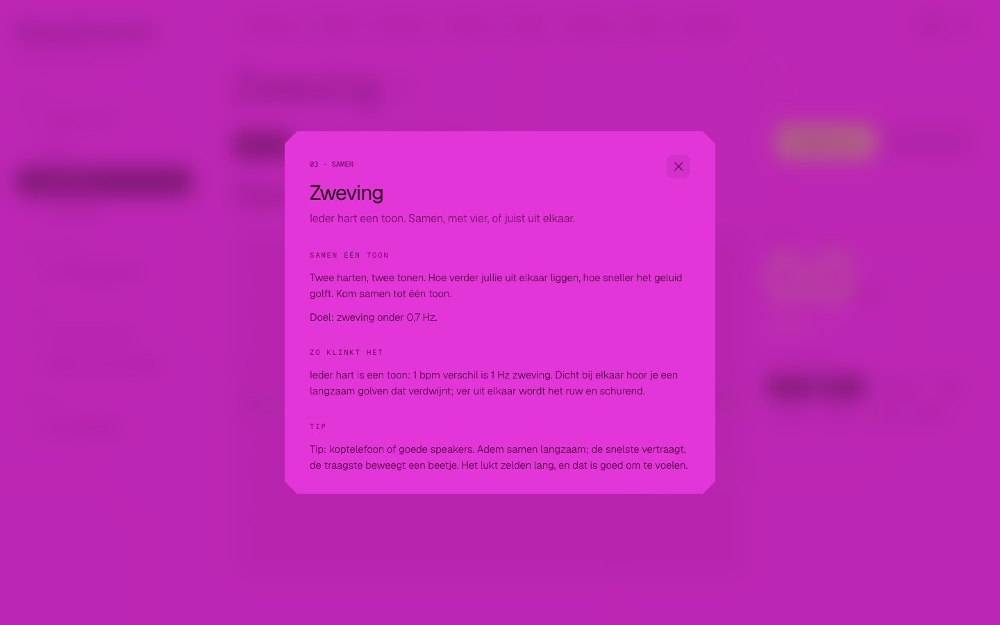
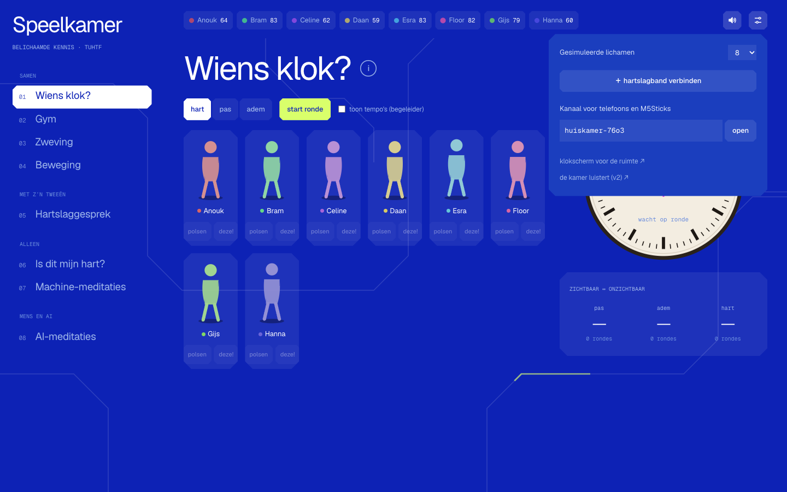

# Handleiding voor docenten en onderzoekers

Deze handleiding is voor wie een sessie met het Lummellab gaat geven: aan studenten, in een workshop of op een onderzoeksdag. Je hoeft niet te programmeren. Wel moet je een uur nemen om de opstelling vooraf één keer zelf te doorlopen.

- [Wat het Lummellab is](#wat-het-lummellab-is)
- [Wat je nodig hebt](#wat-je-nodig-hebt)
- [Voorbereiden](#voorbereiden)
- [De opstelling in de ruimte](#de-opstelling-in-de-ruimte)
- [Voorbeeldprogramma's](#voorbeeldprogrammas)
- [Begeleiden](#begeleiden)
- [Zorgvuldig omgaan met lichaamsdata](#zorgvuldig-omgaan-met-lichaamsdata)
- [Als het niet werkt](#als-het-niet-werkt)

## Wat het Lummellab is

Het Lummellab is een webapp met korte werkvormen over lichaamssignalen: hartslag, adem, beweging en houding. Deelnemers dragen een hartslagband of bewegingssensor. De app maakt die signalen hoorbaar en zichtbaar, en zet ze in een spel, een meditatie of een klein experiment.

Links in de app staan de werkvormen in vier groepen:

| Groep | Werkvorm | In één zin |
|---|---|---|
| met de groep | [Wiens klok?](werkvormen/01-wiens-klok.md) | Een klok tikt iemands hart, pas of adem. Van wie? |
| | [Gym](werkvormen/02-gym.md) | Koekoek (stilstaan als de wachter kijkt) en Herstelslag (intervaltraining met een hartslagcheck). |
| | [Zweving](werkvormen/03-zweving.md) | Ieder hart een toon. Samen, met vier, of juist uit elkaar. |
| | [Beweging](werkvormen/04-beweging.md) | Sensor & kalibratie, stil-wedstrijd, ademzwerm en wie leidt. |
| met z'n tweeën | [Hartslaggesprek](werkvormen/05-hartslaggesprek.md) | Zonder woorden, met elkaars hart in je oor. |
| alleen | [Is dit mijn hart?](werkvormen/06-is-dit-mijn-hart.md) | Tellen, herkennen, raden: hoe goed voel je jezelf? |
| | [Machine-meditaties](werkvormen/07-machine-meditaties.md) | Lummelen bij apparaten die op jouw lichaam lopen. |
| mens en ai | [AI-meditaties](werkvormen/08-ai-meditaties.md) | Een stem zonder lichaam die naar het jouwe luistert. |

Alles werkt ook **zonder sensoren**. De app vult dan aan met gesimuleerde lichamen. Daarmee kun je thuis voorbereiden en in de sessie een werkvorm eerst laten zien voordat iedereen een band om heeft.

*De ⓘ naast elke titel opent dit paneel met de regels en de uitleg.*

## Wat je nodig hebt

**Minimaal**
- Een laptop met **Chrome of Edge**. Web Bluetooth werkt niet in Safari en Firefox.
- Speakers, of een koptelefoon met splitter voor de werkvormen met twee personen.
- Het Lummellab: de gedeployde versie, of lokaal gestart (zie [techniek](techniek.md)). Adres: `…/app.html#lummellab`, of kies het Lummellab op de landingspagina.

**Voor echte lichaamsdata**
- **Hartslagbanden** met Bluetooth die het standaard hartslagprofiel spreken. Getest: Polar H10 en Garmin HRM-Pro Plus. De meeste borstbanden van €30 tot €90 werken. Polsbandjes en horloges meestal niet, of alleen in een speciale uitzendmodus.
- **Bewegingssensoren**, voor adem, houding, pas en stilstaan:
  - een **M5StickC Plus2** met onze firmware (zie [hardware](hardware.md)), of
  - een **telefoon** als zender: die stuurt zijn eigen bewegingssensor door en kan ook een band uitlezen.
- Een **wifi-netwerk** waar telefoons en sticks op kunnen. Een telefoon-hotspot werkt overal. Eduroam werkt niet voor de sticks.

**Handig**
- Een tweede scherm of beamer voor het klokscherm (bij *Wiens klok?*).
- Elastiek of klittenband om een sensor op borst of buik te dragen.
- Een stopwatch en papier voor de nabespreking.

Zie [hardware](hardware.md) voor details over koppelen, draagplekken en aantallen.

## Voorbereiden

Een week van tevoren:
1. Open het Lummellab en klik door alle werkvormen die je wilt gebruiken. Doe het met gesimuleerde lichamen. Het tandwiel ⚙ rechtsboven regelt hoeveel.
2. Lees per werkvorm de pagina in deze map. De ⓘ naast de titel in de app geeft de korte versie.
3. Laad de banden en sticks op. Een M5Stick gaat een paar uur mee met het scherm uit.

Op de dag zelf, een half uur vooraf:
1. Open ⚙ en kies een **kanaal**, bijvoorbeeld `huiskamer-hku1`. Klik op "open". Telefoons en sticks sturen hun data naar dit kanaal.
2. Koppel de hartslagbanden via ⚙ → "＋ hartslagband verbinden". Elke band verschijnt als een gekleurde stip in de balk bovenaan. De band krijgt de naam die hij zelf uitzendt; nummer de banden met een stickertje zodat je weet wie wie is.
3. Zet de sticks aan, of open op elke telefoon de zenderlink die onder het kanaal staat: `…#speelkamer/zender?kanaal=<code>`. Elke telefoon of stick verschijnt als lichaam met ▣.
4. Zet het aantal gesimuleerde lichamen op 0, tenzij je ze bewust wilt gebruiken.
5. Controleer het geluid met de luidsprekerknop rechtsboven.

*⚙ Opstelling: gesimuleerde lichamen, hartslagband verbinden, het kanaal, en de links voor telefoons en het klokscherm.*

Tip: de stippen in de bovenbalk pulseren op elke hartslag. Zo zie je in één blik of alles binnenkomt.

## De opstelling in de ruimte

- **Laptop als dirigent.** Eén laptop draait de werkvorm en speelt het geluid. Zet hem zo dat jij het scherm ziet en de groep het geluid hoort.
- **Scherm wel of niet tonen.** Bij veel werkvormen werkt het beter als deelnemers het scherm níet zien: ze moeten voelen, niet kijken. Bij *Wie leidt?* en de *Stil-wedstrijd* is het scherm juist het spel. Per werkvorm staat aangegeven wat werkt.
- **Ruimte om te bewegen.** Voor *Gym*, *Ademzwerm* en *Wie leidt?* heb je een lege vloer nodig. Voor de meditaties zijn matjes of stoelen fijn.
- **Bluetooth-bereik.** Banden reiken ongeveer tien meter, met lichamen ertussen minder. Wie verder weg moet, gebruikt een telefoon als zender.

## Voorbeeldprogramma's

### Kennismaking, 90 minuten

| Tijd | Wat | Doel |
|---|---|---|
| 0:00 | Banden om, kanaal open, korte uitleg | Iedereen ziet zichzelf in de bovenbalk |
| 0:10 | [Is dit mijn hart?](werkvormen/06-is-dit-mijn-hart.md), alleen *Raden* en *Tellen* | Eerste besef: ik voel minder dan ik denk |
| 0:25 | [Wiens klok?](werkvormen/01-wiens-klok.md), drie rondes per signaal | Wat is zichtbaar en wat niet? |
| 0:45 | [Zweving: samen één toon](werkvormen/03-zweving.md), in tweetallen | Afstemmen zonder woorden |
| 1:05 | [Stil-wedstrijd](werkvormen/04-beweging.md#stil-wedstrijd) | Je lichaam is nooit stil |
| 1:15 | Nabespreking | Van ervaring naar vraag |

### Halve dag: van mens naar machine

1. **Aankomen** (15 min). Banden om. Vijf minuten stil zitten met [Machine-meditaties: Hartslagtijd](werkvormen/07-machine-meditaties.md) op het grote scherm.
2. **Jezelf** (30 min). [Is dit mijn hart?](werkvormen/06-is-dit-mijn-hart.md) volledig, met zekerheid.
3. **Elkaar** (45 min). [Hartslaggesprek](werkvormen/05-hartslaggesprek.md) in tweetallen, daarna [Zweving: kwartet en afstoten](werkvormen/03-zweving.md).
4. **Pauze.**
5. **De groep** (45 min). [Ademzwerm](werkvormen/04-beweging.md#ademzwerm) en [Wie leidt?](werkvormen/04-beweging.md#wie-leidt).
6. **De machine** (45 min). In kleine groepjes het [machine-experiment](werkvormen/07-machine-meditaties.md#het-experiment): eigen tempo tegenover spiegelend. Daarna één [AI-meditatie](werkvormen/08-ai-meditaties.md) met de hele groep.
7. **Terugkoppelen** (30 min). Welke vertaling van lichaam naar data verloor het meest? Welke verraste?

### Sportles of bootcamp, 45 minuten

[Gym](werkvormen/02-gym.md): eerst een paar rondes *Koekoek* als warming-up, daarna *Herstelslag* met 6 × 1 minuut werk en 1 minuut rust.

## Begeleiden

- **Laat eerst voelen, dan kijken.** Begin een werkvorm zonder scherm. Laat pas daarna de data zien. Het verschil tussen wat iemand voelde en wat de grafiek zegt, is meestal het interessantste gesprek.
- **Data is geen waarheid.** Een band kan slagen missen, een sensor kan verschuiven. Behandel afwijkingen als materiaal: "de sensor zegt dat je stil stond, klopt dat?"
- **Niemand hoeft te winnen.** Spellen zoals *Koekoek* en de *Stil-wedstrijd* hebben een winnaar, maar het doel is aandacht voor je lijf.
- **Benoem het membraan.** Vraag steeds: wat heeft de machine van jou gezien, en wat niet? Wat moest je doen om "leesbaar" te worden?
- **Gebruik de ⓘ.** Achter de ⓘ naast elke titel staat de uitleg en de regels. Op het scherm zelf staan bewust weinig woorden, zodat de ervaring centraal staat.

### Algemene nabespreekvragen

- Wat voelde je, en wat liet de app zien? Waar klopte dat niet?
- Wat moest je met je lichaam doen om door de machine "gezien" te worden?
- Welk signaal voelde het meest van jou: hart, adem of beweging? Welk het minst?
- Als je dit aan iemand zonder lichaam moest uitleggen, welke woorden zou je missen?

## Zorgvuldig omgaan met lichaamsdata

Hartslag en adem zijn gezondheidsgegevens. Neem dat serieus, ook in een spel.

- **Vrijwilligheid.** Niemand hoeft een band te dragen. Een gesimuleerd lichaam doet gewoon mee.
- **Geen echte namen nodig.** Gebruik voornamen, kleuren of nummers.
- **Wat er bewaard wordt.** Het Lummellab heeft geen eigen database. Alles draait in de browser. Een paar dingen bewaart de browser lokaal: het gekozen kanaal, de kalibratie van een stick, en de uitkomsten van het machine-experiment. Wis die via de knoppen in de app of door de browsergegevens van de site te wissen.
- **Wat er over het netwerk gaat.** Telefoons en sticks sturen hun data via een **openbare MQTT-server** (HiveMQ) naar het kanaal. Iedereen die de kanaalcode kent, kan meekijken. Gebruik daarom een niet te raden code, en geen namen of andere persoonsgegevens. Banden die direct via Bluetooth aan de laptop hangen, gaan niet over internet.
- **Onthullen.** Bij werkvormen met een verborgen element, zoals verstoppen in *Wiens klok?*, hoort het onthullen achteraf bij het werk. Laat iedereen zien wat er gebeurde.
- **Gezondheid.** De app is geen medisch instrument. Bij *Gym: Herstelslag* gaat de hartslag flink omhoog. Vraag vooraf of iemand hartklachten heeft, en laat mensen in hun eigen tempo meedoen. Hartslagwaarden zeggen niets over hoe gezond iemand is. Vergelijk mensen daar niet op.
- **Onderzoek.** Ga je data verzamelen voor onderzoek, regel dan vooraf geïnformeerde toestemming volgens de richtlijnen van je instelling. Zie per werkvorm de sectie *Voor onderzoekers*.

## Als het niet werkt

| Probleem | Wat je kunt doen |
|---|---|
| "Hartslagband verbinden" doet niets | Gebruik Chrome of Edge. Op een Mac: geef de browser Bluetooth-toegang in Systeeminstellingen → Privacy. |
| Band verschijnt niet in de lijst | Bevochtig de elektroden en doe hem om. De meeste banden zenden alleen als ze huidcontact hebben. Een band kan maar met één apparaat tegelijk verbonden zijn: sluit de sportapp op je telefoon. |
| Stip pulseert niet meer | De band is buiten bereik of verschoven. Wacht een paar seconden; de app verbindt opnieuw. |
| Telefoon stuurt geen beweging | De zenderpagina moet via **https** openen, en op een iPhone moet je toestemming geven voor beweging. Lokaal via `http://192.168…` werkt dat niet: gebruik de gedeployde versie. |
| Stick verschijnt niet | Kijk op het schermpje van de stick of wifi en kanaal kloppen. Zelfde kanaal als in ⚙? Eduroam werkt niet; gebruik een hotspot. |
| Geen geluid | Klik één keer ergens op de pagina (browsers starten geluid pas na een klik) en controleer de luidsprekerknop rechtsboven. |
| Adem blijft "—" | Adem komt uit een bewegingssensor op borst of buik, niet uit een hartslagband. Kalibreer in *Beweging → sensor & kalibratie* en zit een halve minuut stil. |
| Alles loopt traag | Sluit andere tabbladen. Gebruik minder gesimuleerde lichamen. |
