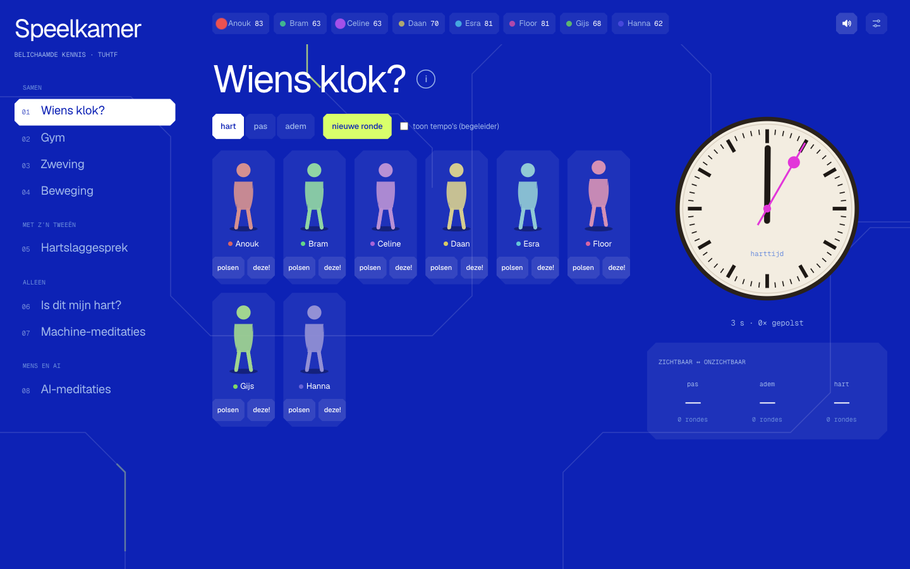

# Wiens klok?

*Een klok tikt iemands hart, pas of adem. Van wie?*

*Een ronde loopt: de klok tikt het hart van één van de figuurtjes. Links de navigatie, bovenin alle lichamen met hun hartslag.*

**Groep** 4 tot 15 · **Duur** 15 tot 30 minuten · **Sensoren** hartslagbanden; voor pas en adem ook bewegingssensoren · **Deelvragen** [1 en 2](../over-tuhtf.md#zes-deelvragen)

## Thematische inbedding

Sommige lichaamssignalen zie je meteen: wie loopt er op de maat? Andere zitten diep vanbinnen: van wie is deze hartslag? *Wiens klok?* zet die signalen naast elkaar en laat de groep merken hoe verschillend zichtbaar ze zijn. Een machine meet ze alle drie even makkelijk. Voor een mens is de pas een kwestie van seconden, de adem van een halve minuut kijken, en het hart soms onvindbaar.

Daarmee raakt de werkvorm aan twee deelvragen. Hoe goed voel je jezelf, en de ander? En wat gebeurt er als een lichaam een getal wordt dat iedereen kan horen? Je eigen hart tikken horen in de ruimte, zonder dat de anderen weten dat het van jou is, is een kleine vorm van ont-lichamen.

## Artistiek statement

Een klok is het oudste instrument om tijd buiten het lichaam te leggen. Hier leggen we hem er weer in terug. De klok tikt niet de tijd van de zon, maar die van één persoon in de kamer, en de groep moet uitzoeken wie. Zo wordt zoeken een vorm van luisteren. Mensen gaan naar elkaars schouders kijken, naar een kaak, naar een blos. Wie mag polsen, raakt de ander aan om te weten.

Het werk gaat over het verschil tussen zichtbaar en voelbaar. Een pas is publiek, een hartslag privé. Een klok maakt het privé publiek, maar anoniem. Dat schuurt, en dat is de bedoeling.

## Werkvorm

**Opstelling.** Iedereen draagt een band. Voor *pas* en *adem* is een bewegingssensor nodig, zoals een M5Stick of telefoon. Zet eventueel het klokscherm op een tweede scherm of beamer: ⚙ → "klokscherm voor de ruimte". Op het laptopscherm staan figuurtjes die deinen bij elke stap; hun borst zwelt met de adem. Het hart zie je niet, tenzij je "polst".

**Stappen**
1. Kies het signaal: **hart**, **pas** of **adem**.
2. Start een ronde. De klok begint te tikken op één willekeurig lichaam.
3. De groep zoekt. Rondlopen, kijken, aanraken als dat mag.
4. Iemand denkt het te weten en klikt op het figuurtje met "deze!". Polsen in de app (een figuurtje aanklikken om het hart te zien) mag ook, maar kost tijd.
5. De app houdt bij hoe lang het zoeken duurde, per signaal.

Doe een paar rondes per signaal, en vergelijk aan het eind de zoektijden.

**Varianten**
- **Aanraken mag / mag niet.** Polsen maakt het intiem. Zonder polsen kijk je naar adem en kleur.
- **Verstoppen.** Fluister de gekozen persoon in dat de klok van hem of haar is. Die probeert de klok te laten vertragen of ongemerkt te blijven.
- **Twee klokken.** Start twee rondes op twee schermen. De twee gekozenen moeten elkaar vinden en hun klokken gelijk laten lopen.
- **Blind.** Laat de groep met de ogen dicht luisteren, alleen bij *hart*. Wie herkent zijn eigen hart?

## Nabespreken

- Welk signaal was het makkelijkst te vinden? Waarom?
- Waar keek je naar bij het hart? Wat bleek een goede aanwijzing, en wat niet?
- Hoe voelde het als de klok van jou was? Ging je je anders gedragen?
- Een machine meet alle drie de signalen even goed. Wat zegt dat over wat "zien" is?

## Voor onderzoekers

- **Wat je meet:** zoektijd per signaal en aantal foute gokken. De verwachting is dat de pas in seconden gevonden wordt en het hart nauwelijks. Dat verschil is het gesprek.
- **Wat je vastlegt:** noteer per ronde welke aanwijzingen mensen gebruikten. Dat is een labelsessie: de groep maakt een eigen taal voor zichtbare lichaamssignalen.
- **Let op:** de klok volgt de band met wat vertraging (Bluetooth, typisch 0,1 tot 0,5 s). Voor zoeken maakt dat niet uit; voor precieze synchronie wel. Pas en adem uit een bewegingssensor zijn schattingen; check in *Beweging → sensor & kalibratie* of ze kloppen.
