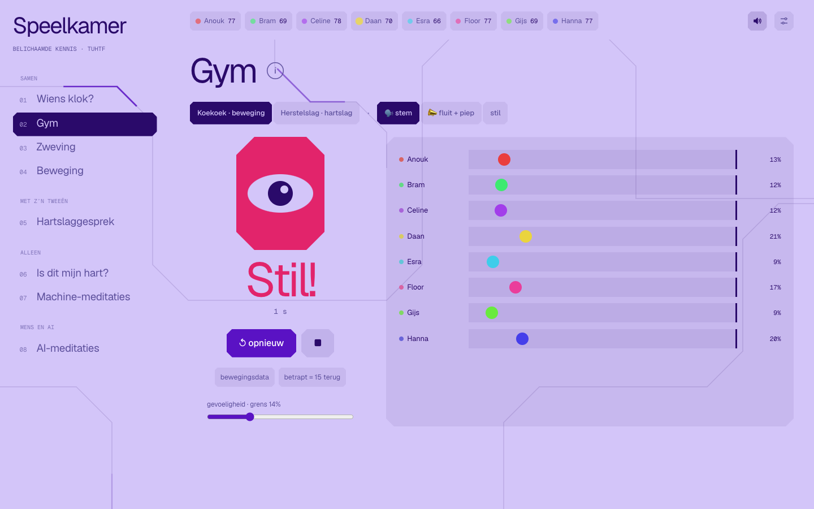
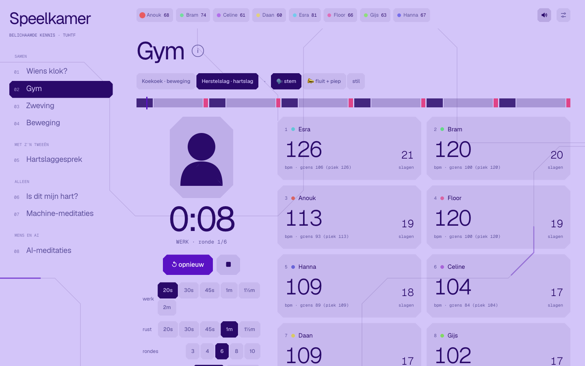

# Gym

*Spellen voor lijf en hart.*

Gym is de plek voor bewegingsspellen. Er zijn er nu twee: **Koekoek** voor beweging en **Herstelslag** voor hartslag. Er kunnen er later meer bij.

**Deelvragen** [4 en 2](../over-tuhtf.md#zes-deelvragen)

## Thematische inbedding

Kun je je lichaam op commando sturen? In een meditatie mag je hart vanzelf zakken. In de sportzaal moet het, en snel, want de wachter kijkt. Gym onderzoekt zelfregulatie onder druk: stilstaan midden in een sprint, je hart omlaag krijgen terwijl je nog naar adem hapt.

Er zit ook een machinevraag in. Bij gewone spellen beslist een mens of je bewoog. Hier beslist een sensor met een drempel. Dat voelt meteen anders: eerlijker, of juist harder? En wat moet je met je lichaam doen om voor de machine "stil" te zijn? Een beetje trillen mag voor de sensor, maar je adem zie je terug in de grafiek. De regels van het spel zijn een datamodel geworden.

## Artistiek statement

Iedereen kent het kinderspel waarin je sluipt terwijl de ander niet kijkt en bevriest zodra hij omdraait. Wij geven de rol van de wachter aan een machine die niet met ogen kijkt maar met een accelerometer, en aan een stem die geen lichaam heeft. Het spel blijft speels, maar wordt ook een studie in hoe het is om bekeken te worden door iets dat alles ziet wat je niet voelt.

Herstelslag neemt dat mee naar de sportschool. Daar leggen we het niet op je spieren, maar op je hart: hoe snel kom je terug na een inspanning? Herstel is normaal een getal achteraf in een app. Hier wordt het een moment van spanning, met een coach die "Koekoek!" roept en kijkt of je hart al gezakt is.

## Omroep: stem, fluit of stil

Beide spellen hebben een omroep met drie standen:
- **Stem.** Twee ElevenLabs-stemmen, vooraf gemaakt zodat ze ook zonder internet werken. **Callum** is de plagerige wachter van Koekoek, **Charlie** de energieke coach van Herstelslag. Wat ze zeggen, staat ook als ondertitel in beeld.
- **Fluit + piep.** Een sportfluit met triller, piepjes zoals bij de piepjestest, en een zoemer als je betrapt bent.
- **Stil.** Alleen beeld.

In de laatste drie seconden van een fase klinken aftelpiepjes.

---

## Koekoek

*Beweeg zolang de wachter niet kijkt. Sta stil als hij omdraait.*

*"Stil!" De wachter kijkt. Rechts de voortgang per speler, met de bewegingsdata aan.*

**Groep** 2 tot 10 · **Duur** 5 tot 15 minuten · **Sensoren** een bewegingssensor per speler (M5Stick of telefoon, op de borst of in de hand)

### Werkvorm

**Opstelling.** Een lege vloer. De spelers staan aan één kant, de laptop staat aan de andere kant met het scherm naar de groep, of de begeleider houdt het scherm voor zich.

**Hoe het werkt.** Elke speler heeft een balk die vult als je beweegt. Hoe meer je beweegt, hoe sneller je vooruitkomt. Je hoeft dus niet echt door de ruimte te lopen: rennen op de plaats, springen of dansen telt ook. De wachter roept "Annemaria… koekoek!" en draait zich om. Na een halve seconde moet je doodstil staan. Wie dan nog beweegt boven de drempel, gaat 15 terug, of is af als je de strenge stand kiest. Wie als eerste de finish haalt, wint.

**Stappen**
1. Kies het aantal spelers, de omroep en de gevoeligheid (de drempel).
2. Start. De wachter zegt "Klaar? Ik draai me om…"
3. Spelen. De wachter kijkt op willekeurige momenten.
4. Bij een winnaar stopt het spel.

**Varianten**
- **Data aan.** Laat de bewegingsgrafiek zien. Spelers zien hoe stil ze echt waren, en ontdekken dat ademen al zichtbaar is.
- **Strenge wachter.** Zet de drempel laag. Nu moet je ook je adem inhouden.
- **Echte afstand.** Laat spelers wél door de ruimte lopen, met de sensor in de hand. Wie de laptop aantikt, wint.

### Nabespreken

- Wat deed je met je lichaam om stil te staan? Wat was het moeilijkste deel om stil te houden?
- Voelde de machine als een eerlijke wachter?
- Wat zag de sensor dat jij niet voelde?

---

## Herstelslag

*Intervaltraining: werk, rust, en aan het eind van de rust kijkt de wachter naar je hartslag.*

*Een werkblok: bovenaan de tijdlijn van alle rondes, rechts per speler de hartslag, de grens en het aantal slagen.*

**Groep** 1 tot 10 · **Duur** 15 tot 30 minuten · **Sensoren** een hartslagband per speler · Gemaakt als prototype voor een CrossFit-box.

### Werkvorm

**Hoe het werkt.** Een vast intervalschema:
1. **Werk** (standaard 1 minuut). Vol gas: burpees, roeien, touwtjespringen, wat bij de groep past. Elke hartslag tijdens het werk is een punt.
2. **Rust** (standaard 1 minuut). De coach kondigt de rust aan. Tien seconden voor het eind zegt hij "Nog tien seconden".
3. **Koekoek.** Aan het eind van de rust kijkt de coach naar ieders hartslag. Zit je onder je grens, dan is het goed. Zit je erboven, dan kost elke slag te veel je 10 punten.
4. Dan begint de volgende ronde. De coach meldt de laatste ronde en het einde.

Het spel beloont twee dingen tegelijk: hard werken, en snel herstellen. Wie zich alleen maar inhoudt, scoort weinig. Wie zich helemaal leegtrekt, haalt de grens niet.

**Instellingen**
- Werk: 20 seconden tot 2 minuten.
- Rust: 20 seconden tot 1,5 minuut.
- Rondes: 3, 4, 6, 8 of 10.
- **Grens:** een vast aantal slagen onder je eigen piek uit die ronde (bijvoorbeeld piek − 20), of een absolute hartslag. De relatieve grens is eerlijker. Iemand met een rustige basishartslag heeft dan geen voordeel.

Bovenaan loopt een tijdlijn van het hele programma mee. Onderaan staat per speler een tegel, en een tabel met alle hartslagchecks.

### Nabespreken

- Merkte je dat je je hart kon laten zakken? Wat deed je daarvoor: adem, houding, gedachten?
- Hoe verhield het gevoel van "uitgeput" zich tot het getal?
- Werkte de spanning van de check, of zat die je herstel juist in de weg?

### Voor onderzoekers (beide spellen)

- **Wat je meet:** bij Koekoek de beweging per speler op het kijkmoment (in mg), en hoe vaak iemand betrapt wordt. Bij Herstelslag per ronde de piekhartslag, de hartslag bij de check en het verschil (herstel in 1 minuut, een bekende fitnessmaat).
- **Wat je vastlegt:** de checktabel van Herstelslag kun je na afloop overschrijven of fotograferen. Interessant is het verloop over de rondes: wordt herstel trager naarmate je vermoeider raakt, of leer je het juist?
- **Let op:** hartslag loopt een paar seconden achter op inspanning, en een band kan bij veel bewegen een slag missen. Herstelslag is geen medische test. Laat mensen met hartklachten niet zonder overleg meedoen.
