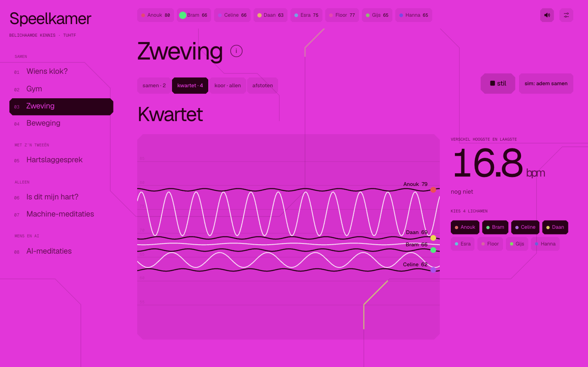

# Zweving

*Ieder hart een toon. Samen, met vier, of juist uit elkaar.*

**Groep** 2 tot de hele groep · **Duur** 10 tot 25 minuten · **Sensoren** hartslagbanden · **Deelvraag** [3](../over-tuhtf.md#zes-deelvragen)

## Thematische inbedding

Kun je je afstemmen op een ander lichaam zonder woorden, en zonder je eigen lichaam direct te kunnen besturen? Je hartslag kun je niet zomaar kiezen. Je kunt hem wel beïnvloeden: met adem, met spanning, met aandacht. Zweving maakt het verschil tussen twee harten hoorbaar, en vraagt je dat verschil samen te laten verdwijnen.

Het is misschien de puurste vorm van het membraan tussen mensen. Je hoort de ander niet direct, alleen de wrijving tussen jullie. Er is geen leider en geen afspraak, alleen een geluid dat rustiger wordt als jullie dichter bij elkaar komen. Wie beweegt naar wie? Wie wacht?

## Artistiek statement

Twee stemvorken die bijna even hoog klinken, maken samen een golvend geluid: *wawawa*. Musici noemen dat zweving, en stemmen hun instrument door het weg te laten gaan. Wij stemmen geen snaren, maar harten. Elk hart krijgt een toon, en 1 slag per minuut verschil wordt 1 golf per seconde. Liggen jullie ver uit elkaar, dan schuurt het. Komen jullie samen, dan wordt het golven trager, tot er één toon overblijft.

Het werk vraagt iets onmogelijks: stem je hart af op dat van een ander. Toch lukt het soms, en dat moment klinkt als een akkoord dat eindelijk klopt. In de variant *Afstoten* draaien we het om. Daar moet je juist uit elkaars buurt blijven, zonder af te spreken wie omhoog gaat en wie omlaag. Samen verschillend zijn blijkt net zo moeilijk als samen gelijk zijn.

## Werkvorm

**Opstelling.** Iedereen een band om. Zitten of staan in een kring, met speakers in het midden. Het scherm toont gekleurde snaren die trillen op de zweving. Het werkt goed als deelnemers het scherm níet zien en alleen luisteren.

*Kwartet: vier harten als trillende snaren. Hoe verder ze uit elkaar liggen, hoe onrustiger de golven.*

**Vier varianten**

| Variant | Wie | De opdracht | Doel |
|---|---|---|---|
| **Samen één toon** | 2 | Twee harten, twee tonen. Hoe verder uit elkaar, hoe sneller het geluid golft. Kom samen tot één toon. | zweving onder 0,7 Hz |
| **Kwartet** | 4 | Vier harten, zes zwevingen tegelijk. Het akkoord schuurt tot iedereen dezelfde toon vindt. Wie wacht op wie? | alle vier binnen 1,5 bpm |
| **Koor** | iedereen | Iedereen klinkt. Een wolk van tonen die alleen helder wordt als de hele groep samenvalt. | hele groep binnen 3 bpm |
| **Afstoten** | 3 | Omgekeerd. Kom je in de buurt van iemands hart, dan begint het te zoemen en te schuren. Blijf uit elkaars buurt. | alle harten minstens 6 bpm uit elkaar |

**Stappen**
1. Kies de variant en kies wie er klinkt (bij *Samen*, *Kwartet* en *Afstoten*).
2. Geef de deelnemers even om hun eigen toon te herkennen. Laat één persoon diep in- en uitademen en luister hoe de toon meebeweegt.
3. Start. Geef 3 tot 5 minuten.
4. Het scherm laat zien wanneer het doel bereikt is.

**Tips voor deelnemers** (vertel dit niet meteen, laat ze het eerst zelf ontdekken)
- Langzaam uitademen verlaagt je hartslag. Snel inademen of je spieren aanspannen verhoogt hem.
- Je hart reageert met een paar seconden vertraging. Geduld.
- In het kwartet is het slim om op het middelste hart af te stemmen.

## Nabespreken

- Wat deed je om je hart te bewegen? Werkte het?
- Wie paste zich aan wie aan? Wist je dat tijdens het spel?
- Was samenvallen een fijne ervaring, of gaf afstoten je meer controle?
- Wat hoorde je eigenlijk: de ander, jezelf, of het verschil?

## Voor onderzoekers

- **Wat je meet:** het verschil in hartslag tussen de deelnemers over de tijd, en hoe lang een groep in het doel blijft.
- **Interessant:** wie beweegt er in een tweetal, de hoogste of de laagste hartslag? Leggen mensen met een hogere hartslag zich vaker neer bij de ander?
- **Let op:** dit meet gemiddelde hartslag over een paar slagen, niet de exacte slag. Hartslag schommelt ook vanzelf met de adem (ongeveer 3 tot 10 bpm). Een kort moment van samenvallen kan toeval zijn; kijk naar hoe lang het duurt.
