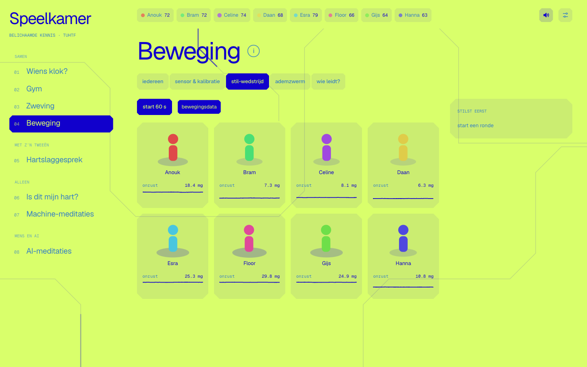
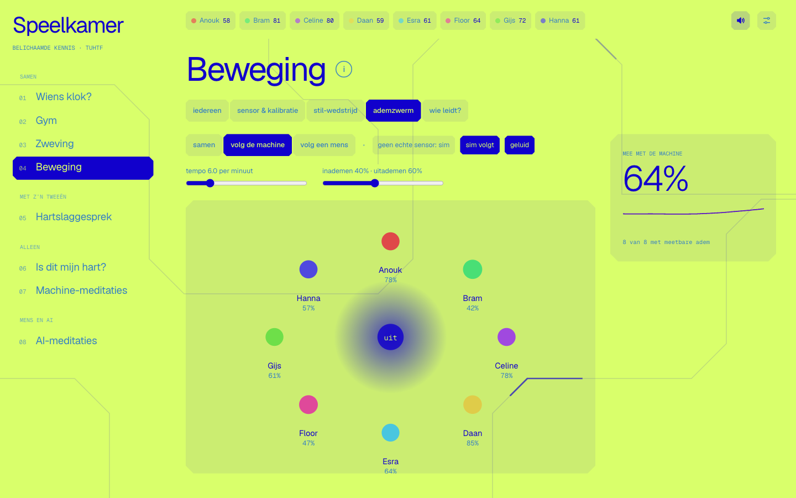
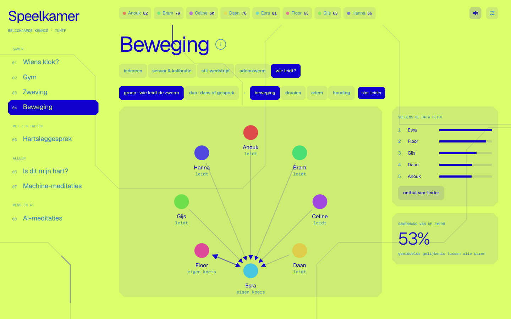
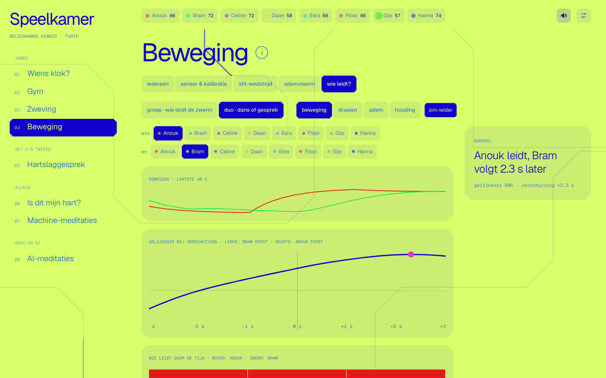

# Beweging

*Stilstaan, samen ademen, zien wie er leidt.*

Beweging bundelt alles wat uit een bewegingssensor komt: pas, houding, kanteling, adem, sprongen, draaien en onrust. Er zijn vijf onderdelen:

| Onderdeel | Wat | Deelvraag |
|---|---|---|
| **iedereen** | Live overzicht van alle lichamen: activiteit, houding, adem. | 2 |
| [**sensor & kalibratie**](#sensor--kalibratie) | Eén sensor van dichtbij: kalibreren, draagplek kiezen, ruwe data bekijken. | 2 |
| [**stil-wedstrijd**](#stil-wedstrijd) | Wie staat het stilst? | 2 en 4 |
| [**ademzwerm**](#ademzwerm) | Samen ademen, met de machine of met één mens als gids. | 3 |
| [**wie leidt?**](#wie-leidt) | Wie zet een beweging in, en wie volgt? Voor groepen, dansers en gesprekken. | 3 |

**Sensoren.** Een M5StickC Plus2, een telefoon als zender, of een Polar H10 (die naast hartslag ook beweging kan doorgeven). Zie [hardware](../hardware.md). Een hartslagband alleen is niet genoeg: die meet geen beweging.

## Waarom beweging naast hartslag

Een hartslag reageert traag, pas na tien tot veertig seconden, en voelt van binnenuit nauwelijks. Beweging is direct en zichtbaar. Adem zit daartussen: half bewust, en goed voelbaar. Het is een brug tussen wil en lijf. Juist in de kloof tussen de signalen wordt belichaamde kennis zichtbaar: stilstaan met een jagend hart, of bewegen met een rustig hart.

---

## Sensor & kalibratie

**Groep** 1 tot 3 · **Duur** 10 tot 20 minuten · **Deelvraag** [2](../over-tuhtf.md#zes-deelvragen)

### Thematische inbedding

Wat blijft er over van een lichaam als het data wordt? Hier kun je dat letterlijk zien. Een sensor van een paar gram geeft vijftig keer per seconde zes getallen: versnelling en draaisnelheid in drie richtingen. Al het andere, zoals adem, houding, pas en schrik, is een interpretatie die wij erbovenop bouwen. Die interpretatie hangt af van waar je de sensor draagt, hoe je hem kalibreert en welke drempels je kiest. Dit onderdeel maakt die keuzes zichtbaar en aanpasbaar.

### Artistiek statement

Een lichaam dat stilstaat, staat nooit stil. Op de grafiek van een sensor op je borst zie je je adem als een trage golf, je hartslag soms als een klein tikje erbovenop, en alles wat je kaak en schouders doen als ruis. Dit onderdeel is een vergrootglas. Het laat zien hoe een machine je ziet, en daarmee ook wat ze niet ziet. Kalibreren is hier een ritueel: drie seconden stilliggen zodat de machine weet wat nul is, rechtop staan zodat ze weet wat rechtop is. Je leert de machine je lichaam kennen, en zij leert jou hoe je eruitziet als getal.

### Werkvorm

1. **Kies de draagplek**: borst, buik, onderrug, pols, enkel, bovenbeen, hoofd of in de hand. Bij elke plek staat wat je daar redelijkerwijs kunt meten (✓ goed, ~ soms, – niet).
2. **Kalibreer**:
   - **Nulpunt gyro.** Leg de sensor 3 seconden helemaal stil.
   - **Rechtop.** Bevestig de sensor, ga rechtop staan en druk op "dit is rechtop".
   - **Assen van de stick** (alleen M5Stick). Eén keer rechtop, één keer plat met het scherm omhoog. Daarna draait het 3D-model van de stick mee met je lichaam.
   - **Adem.** Sensor strak op borst of buik. Na twee à drie ademhalingen verschijnt het tempo.
3. **Probeer uit**: adem heel langzaam, hijg, spring, draai rond, ga op je hoofd staan. De tegels laten zien wat de sensor herkent.

**Wat de getallen betekenen**
- **Zwaartekracht** hoort in rust 1000 mg te zijn.
- **Ademkwaliteit** combineert signaalsterkte met regelmaat. Bij lopen of springen zakt hij naar 0, en dan zegt de app eerlijk "geen adem". Dat is een bewuste keuze: liever geen getal dan een verzonnen getal.
- **Adem** wordt per ademhaling herkend, van heel langzaam (3 per minuut) tot hijgen (80 per minuut).
- **Sprong**: in de lucht voelt de sensor bijna niets (vrije val). Uit de vliegtijd volgt de hoogte.
- **Draai**: snelle rotaties worden opgeteld tot hele omwentelingen.

**Toepassingen om uit te proberen:** houding tijdens werken (onderrug), ademoefeningen (buik), hoofdstand en acrobatiek (onderrug of borst), pas en cadans (enkel of bovenbeen).

### Voor onderzoekers

Dit is het onderdeel om het datamodel te bespreken. Wat is "adem" voor deze sensor? Een golf in één richting, die we herkennen als hij sterk genoeg is boven de ruis. Wat valt daarbuiten? Adem die je in je flanken voelt, of een ademhaling die je inhoudt. Laat studenten zelf een drempel kiezen en kijken wat er dan wel en niet als adem telt.

---

## Stil-wedstrijd

*Sta zo stil mogelijk. De vloer versterkt elke beweging tot gekraak. Je lichaam is nooit stil.*

*Stil-wedstrijd met acht lichamen. Onder elk figuurtje de onrust in mg.*

**Groep** 2 tot 15 · **Duur** 5 tot 10 minuten · **Deelvragen** [2 en 4](../over-tuhtf.md#zes-deelvragen)

### Thematische inbedding

Stilstaan lijkt de afwezigheid van beweging. Een gevoelige sensor laat zien dat het een actieve prestatie is: je evenwicht corrigeert voortdurend, je adem beweegt je borstkas, je hart duwt je lichaam elke slag een fractie naar voren. De stil-wedstrijd maakt die onzichtbare activiteit hoorbaar.

### Artistiek statement

We maken van stilte een geluid. Elke trilling die de sensor oppikt, klinkt als gekraak van een oude houten vloer. Hoe stiller je staat, hoe stiller de kamer. Het spel is simpel en altijd hetzelfde: niemand wint echt, want niemand staat ooit stil. Het werk gaat over de onrust die we de hele dag met ons meedragen zonder het te merken.

### Werkvorm

1. Iedereen draagt een sensor, liefst op dezelfde plek (borst of onderrug).
2. Start. Iedereen probeert zo stil mogelijk te staan. De onrust per persoon klinkt als gekraak en staat als kaartje op het scherm, met een kleine grafiek.
3. Na een minuut: wie had de minste onrust?

**Varianten**
- **Data aan of uit.** Zonder data hoor je alleen het gekraak. Met data zie je per persoon de grafiek, en kun je achteraf bespreken wanneer het misging.
- **Op één been**, met de ogen dicht, of na tien squats.
- **Adem vasthouden**: hoeveel van je onrust is adem?

**Onrust**, bij een echte sensor: de gemiddelde trilling van de versnelling over de laatste seconde (in mg), plus een deel van de draaisnelheid. Ademen alleen geeft ongeveer 2 tot 5 mg; wiebelen al snel 10 tot 30.

### Nabespreken

Waarom wiebelde jij meer dan je dacht? Wat deed je adem, je kaak, je knieën?

---

## Ademzwerm

**Groep** 3 tot 15 · **Duur** 10 tot 20 minuten · **Deelvraag** [3](../over-tuhtf.md#zes-deelvragen)

### Thematische inbedding

Samen ademen is een van de oudste vormen van afstemming: in koren, in rituelen, in een babykamer. Het gebeurt vaak vanzelf. Ademzwerm vraagt wie dat ritme dan bepaalt. Is het de groep als geheel? Een machine die voorademt? Of één persoon die, zonder het te zeggen, de rest meeneemt? Onderzoek naar diergroepen laat zien dat een kleine geïnformeerde minderheid een hele zwerm kan sturen. Geldt dat ook voor adem?

### Artistiek statement

Een lamp die ademt. Hij wordt feller als jullie samen inademen, en zachter als jullie uit elkaar lopen. Een luchtgeluid zwelt aan en ebt weg met de adem. In de variant met de machine ademt de lamp voor, in een tempo dat geen mens zou kiezen: langer, trager, of juist met een vreemd korte inademing. Kun je een machine nadoen die niet hoeft te ademen? In de variant met een mens als gids ademt één persoon voor, en de rest volgt zonder te weten hoe goed. Het werk maakt van ademen een gesprek zonder woorden.

### Werkvorm

**Opstelling.** Iedereen een bewegingssensor strak op borst of buik. Zitten in een kring. Alleen lichamen met meetbare adem tellen mee (ademkwaliteit boven 35%). Zet "alleen echte sensoren" aan als je geen gesimuleerde lichamen wilt meetellen.

*Volg de machine: de gloed in het midden ademt voor, de stippen zijn de deelnemers. Rechts hoeveel procent er samen ademt.*

**Drie varianten**
- **Samen.** Geen leider. De lamp ademt met het gemiddelde. Hoe gelijker jullie ademen, hoe feller hij wordt.
- **Volg de machine.** De lamp en het luchtgeluid ademen voor, in een tempo en een verhouding tussen in- en uitademen die jij kiest. Iedereen probeert mee te ademen. Per persoon zie je hoe goed dat lukt.
- **Volg een mens.** Kies één persoon als bron. De rest probeert zijn of haar adem na te doen, zonder te praten. Wie merkt het als de leider ineens versnelt?

**Maten**
- **Samen-adem**: 100% betekent dat iedereen op hetzelfde moment inademt.
- **Meeademen**: per persoon hoe dicht je bij de gids zit (100% gelijk, 0% precies tegengesteld).

### Nabespreken

- Merkte je dat je ging meeademen? Wanneer verloor je het?
- Hoe was het om een machine na te doen? Was dat anders dan een mens nadoen?
- Voor de gids: voelde je dat de groep je volgde?

---

## Wie leidt?

**Groep** 2 tot 15 · **Duur** 10 tot 30 minuten · **Deelvraag** [3](../over-tuhtf.md#zes-deelvragen)

### Thematische inbedding

In een groep die samen beweegt, lijkt iedereen tegelijk te gaan. Een machine kan zien dat dat niet zo is: de een begint een fractie eerder, de ander volgt een halve seconde later. *Wie leidt?* maakt die verborgen volgorde zichtbaar. Het is dataficatie van iets wat we normaal alleen aanvoelen. Klopt het gevoel van wie er leidde met wat de machine ziet? En wat als het niet klopt: wie heeft er dan gelijk?

### Artistiek statement

Leiden en volgen zijn rollen die we zelden hardop benoemen. In een gesprek leunt de een naar voren en de ander volgt, zonder dat iemand het merkt. Tussen twee dansers wisselt het leiden soms per maat. Dit onderdeel tekent pijlen tussen lichamen: van wie begint naar wie volgt. Die pijlen zijn geen waarheid, maar een voorstel van een machine dat je kunt tegenspreken. Het meest interessante moment is als iemand die dacht te volgen, ineens de leider blijkt.

### Werkvorm

**Twee standen**

*Groep: pijlen van wie leidt naar wie volgt, met een ranglijst en de mate van samen bewegen.*

- **Groep.** Pijlen tussen alle lichamen, met per persoon een rol: *leidt*, *volgt*, *meebeweger* of *eigen koers*. Plus een maat voor hoe samen de groep beweegt.
- **Duo.** Twee mensen. Een curve laat zien bij welke verschuiving (tot 3 seconden) hun signalen het meest op elkaar lijken, met een tijdlijn van wie er op elk moment voorging.

*Duo: de curve laat zien bij welke verschuiving twee signalen het meest op elkaar lijken ("Anouk leidt, Bram volgt 2,3 s later").*

**Vier kanalen**
- **Beweging**: wie begint met bewegen of stilstaan. Voor een zwerm door de ruimte.
- **Draaien**: draaisnelheid. Voor dansers: wie zet een draai in?
- **Adem**: wie ademt voor, wie ademt na. Voor een gesprek of een stil duo.
- **Houding**: kanteling. Spiegelen in een gesprek: leunt de een naar voren, en volgt de ander?

**Voorbeelden**
- **Zwerm.** De groep loopt door de ruimte zonder af te spreken wie leidt. Iedereen mag starten, stoppen en van richting veranderen. Na drie minuten: vraag iedereen wie er volgens hen leidde. Toon dan de pijlen.
- **Geheime leider.** Wijs stiekem één leider aan. Vindt de machine die persoon? Vindt de groep die persoon? Met een gesimuleerde leider kun je dit eerst laten zien.
- **Dans.** Twee dansers met elk een stick op de onderrug. Kanaal *draaien* of *beweging*. Wisselt het leiden tijdens de dans?
- **Gesprek of date.** Sticks op de borst. Kanaal *houding* laat spiegelen zien, kanaal *adem* of iemand meeademt. Laat het gesprek over iets gaan dat er niet toe doet, en bespreek achteraf de grafiek.

### Nabespreken

- Wie dacht je dat er leidde? Klopte dat met de pijlen?
- Mensen die denken te volgen, blijken vaak te leiden, en andersom. Waarom zou dat zijn?
- Bij het gesprek: wist je dat je de ander spiegelde?

### Voor onderzoekers

- **Methode:** elk lichaam levert tien keer per seconde een getal per kanaal. Voor elk paar wordt gekeken of het signaal van B lijkt op dat van A, maar dan een halve tot twee seconden later (kruiscorrelatie). Dan volgt B, en leidt A.
- **Grenzen:** gelijkenis is geen oorzaak. Twee mensen die allebei op de muziek reageren, lijken elkaar te volgen terwijl ze allebei de muziek volgen. Bij weinig beweging is de uitkomst onbetrouwbaar.
- **Voor labelen:** laat deelnemers vóór het tonen van de pijlen zelf een schets maken van wie wie volgde. Het verschil tussen menselijk en machinaal labelen is het materiaal.
