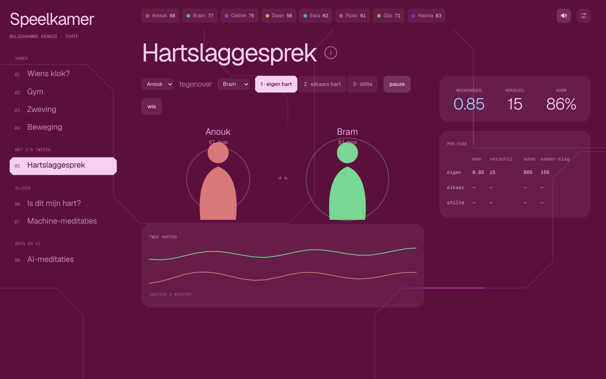

# Hartslaggesprek

*Zonder woorden, met elkaars hart in je oor.*

**Groep** 2 (meerdere duo's na elkaar) · **Duur** 10 tot 15 minuten per duo · **Sensoren** twee hartslagbanden, koptelefoon met splitter of twee oortjes · **Deelvraag** [3](../over-tuhtf.md#zes-deelvragen)

## Thematische inbedding

Wat ik voel, moet ik eerst coderen in woorden, gebaren of aanraking. De ander moet het weer decoderen in een eigen, ander lichaam. Het hartslaggesprek slaat dat coderen over: je hoort direct het hart van de ander. Toch blijft er een membraan. Je hoort een geluid, geen gevoel. En je eigen lichaam moet er iets mee.

Uit onderzoek naar koppels, koren en rituelen weten we dat harten soms gaan meebewegen: ze stijgen en dalen samen. Het hartslaggesprek vraagt of dat ook gebeurt als je elkaars hart hoort, en wat er overblijft als het geluid wegvalt.

## Artistiek statement

Twee mensen tegenover elkaar. Ze praten niet, maar kijken elkaar aan. In hun oor klinkt eerst hun eigen hart, dan dat van de ander, dan niets. Het is een gesprek zonder inhoud, alleen ritme. Het intiemste wat we van een ander kunnen horen, is meestal alleen hoorbaar met je oor op iemands borst. Hier klinkt het via een kabeltje, en dat maakt het tegelijk dichterbij en verder weg.

Het werk gaat over luisteren als lichamelijke handeling. Luister je naar een hart, of luister je mee? En als jullie harten samen gaan bewegen, wie is er dan bij wie op bezoek?

## Werkvorm

**Opstelling.** Eén laptop, twee banden. Gebruik een koptelefoonsplitter, of geef ieder één oortje: **links** is wat de linker persoon hoort, **rechts** wat de rechter hoort. Twee stoelen tegenover elkaar, op een armlengte afstand.

*Twee figuren, hun hartslagen over de tijd, en rechtsboven de maten: meebewegen, verschil, adem.*

**Drie fases**, elk 2 à 3 minuten:
1. **Eigen hart.** Ieder hoort het eigen hart.
2. **Elkaars hart.** Ieder hoort het hart van de ander.
3. **Stilte.** Geen geluid. Alleen kijken.

Niet praten, wel aankijken.

Het scherm toont beide hartslagen over de tijd, en per fase drie maten:
- **Meebewegen**: hoe gelijk de harten stijgen en dalen (−1 tot 1, over de laatste minuut).
- **Verschil**: gemiddeld aantal bpm uit elkaar.
- **Adem**: hoe gelijk jullie ademen, als er bewegingssensoren zijn.

Na afloop vergelijken jullie samen de tabel: gingen jullie harten mee met elkaar toen je elkaar hoorde?

**Varianten**
- **Rug aan rug.** Zonder aankijken: hoeveel van het meebewegen kwam door het kijken?
- **Ogen dicht** in alle fases.
- **Vreemden tegenover vrienden.** Doe het met iemand die je net kent, en daarna met iemand die je goed kent.

## Nabespreken

- Hoe klonk het hart van de ander? Wat dacht je erbij?
- Ging je anders ademen toen je de ander hoorde?
- Wat gebeurde er in de stilte? Hoorde je het hart van de ander nog?
- Klopte de tabel met hoe verbonden je je voelde?

## Voor onderzoekers

- **Wat je meet:** de correlatie tussen de twee hartslagen per fase, en het gemiddelde verschil. De vergelijking tussen fase 1 en fase 2 is het experiment; fase 3 laat zien of het effect blijft.
- **Ontwerp:** wissel de volgorde van fase 1 en 2 tussen duo's om volgorde-effecten te voorkomen.
- **Let op:** harten bewegen ook samen door gedeelde prikkels, zoals een geluid in de ruimte of samen lachen. Een paar minuten is kort; effecten in de literatuur zijn klein en verschillen sterk per duo. Of het hier lukt, is precies de vraag.
