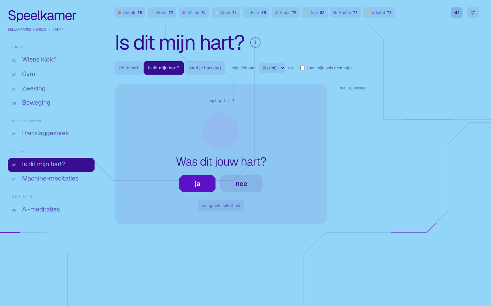

# Is dit mijn hart?

*Tellen, herkennen, raden: hoe goed voel je jezelf?*

**Groep** 1 per laptop (of om de beurt) · **Duur** 10 tot 25 minuten · **Sensoren** een hartslagband, koptelefoon · **Deelvraag** [1](../over-tuhtf.md#zes-deelvragen)

## Thematische inbedding

Voordat je belichaamde kennis aan iemand anders of aan een machine kunt overdragen, moet je haar zelf kunnen waarnemen. Dat vermogen heet **interoceptie**: je hart, je adem, je spanning van binnenuit voelen. Mensen verschillen daarin enorm. Sommigen voelen hun hart in elke slag, anderen nooit. En de meesten denken dat ze het beter kunnen dan ze het kunnen.

*Is dit mijn hart?* is daarom het beginpunt van het hele project. Het zet een simpele vraag centraal: weet je eigenlijk wat je lichaam doet? De hartslagband weet het in ieder geval wel. Dat is een ongemakkelijke omkering. De machine kent jouw hart beter dan jij.

## Artistiek statement

Drie kleine proeven, steeds intiemer. Eerst gok je: hoe snel klopt je hart nu? Dan tel je, met je ogen dicht, alleen wat je echt voelt. Tot slot hoor je een hartslag in je oor en moet je zeggen: is dit de mijne? Soms is hij het. Soms is hij net iets te snel, of te traag. Soms is het het hart van iemand anders in de kamer.

Het werk maakt van jezelf herkennen een raadsel. Een spiegel toont je gezicht, en dat herken je meteen. Een hartslag is ook een spiegel, maar dan een die je bijna nooit ziet. Wie de vraag "is dit mijn hart?" stelt, merkt hoe vreemd het eigen lichaam kan klinken.

## Werkvorm

Drie taken. Doe ze in deze volgorde.

**1. Raden.** "Hoe snel klopt je hart nu?" Gok, zonder te voelen. Doe het na elke andere oefening opnieuw. De app laat zien hoe ver je er gemiddeld naast zit.

**2. Tellen.** Ga zitten, sluit je ogen als je wilt. Tel je hartslagen in stilte, zonder aan je pols of hals te voelen. Het venster duurt 25, 35 of 45 seconden; je weet niet welke. Daarna vul je in hoeveel je telde. De app berekent je **interoceptieve nauwkeurigheid**: het gemiddelde over je telvensters van 1 − |echt − geteld| / echt.

**3. Herkennen.** Acht keer twaalf seconden. Zet een koptelefoon op, zit stil en voel van binnenuit mee. Soms hoor je je eigen hart, live. Soms jouw ritme maar net te snel of te traag, soms het hart van iemand anders in de ruimte. Na elke keer kies je met grote knoppen **ja** of **nee**. Zet "vraag ook zekerheid" aan voor een tweede vraag: hoe zeker ben je?

*Na twaalf seconden luisteren: was dit jouw hart?*

Met zekerheid zie je niet alleen hoe vaak je goed zat, maar ook of je weet wát je weet. Wie zeker is bij goede antwoorden en twijfelt bij foute, heeft een goed beeld van de eigen waarneming.

## Nabespreken

- Zat je dichter bij je echte hartslag dan je dacht?
- Wat voelde je bij het tellen: je hart, je pols in je vingers, of iets anders?
- Bij herkennen: waar lette je op? Het tempo? De wisselingen?
- Werd je beter na een paar keer? Of juist onzekerder?

## Voor onderzoekers

- **Wat je meet:** drie bekende maten uit interoceptie-onderzoek. Raden is een schatting zonder waarneming. Tellen is de heartbeat counting task (Schandry). Herkennen lijkt op een discriminatietaak; met zekerheid krijg je ook een maat voor metacognitie (*interoceptive awareness*).
- **Waarom zo getoetst:** een band meldt slagen met wat vertraging via Bluetooth. Daarom toetsen we niet of een klik precies op je slag valt, zoals in het lab. We toetsen of je je eigen tempo en wisselingen herkent.
- **Let op:** de teltaak wordt bekritiseerd, omdat mensen ook schatten op basis van wat ze over hartslag weten. Mensen tellen meestal te weinig. Gebruik de uitkomsten als gespreksstof, niet als diagnose.
