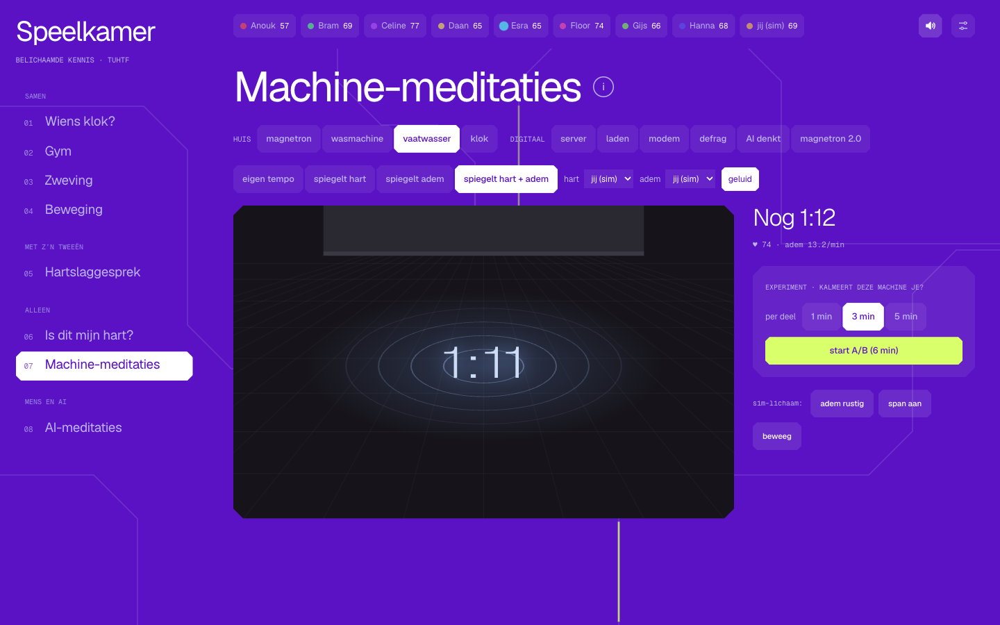
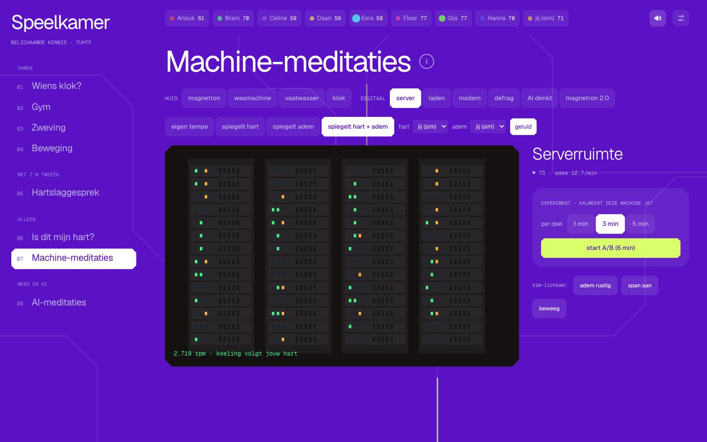
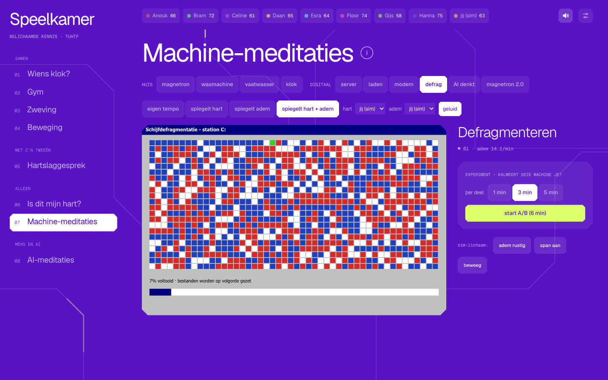
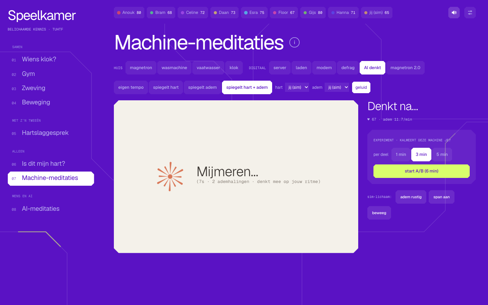

# Machine-meditaties

*Lummelen bij apparaten die op jouw lichaam lopen.*

**Groep** 1 tot 4 per scherm, of een groep met beamer · **Duur** 5 tot 10 minuten per machine · **Sensoren** een hartslagband en/of een bewegingssensor op borst of buik · **Deelvraag** [5](../over-tuhtf.md#zes-deelvragen)

## Thematische inbedding

Dit is de werkvorm die het meest direct over lummelen gaat. Er zitten twee vragen in die elkaar spiegelen.

**Kunnen wij lummelen terwijl machines werken?** We brengen een groot deel van ons leven door met wachten op machines: een magnetron die piept, een wasmachine die draait, een laadbalk die vult. Meestal pakken we onze telefoon. Toch kijken veel mensen ook gewoon, zonder iets te verwachten, naar een draaiend plateau of een tellende vaatwasser. Is dat verloren tijd, of een vergeten vorm van meditatie?

**Kunnen we machines leren lummelen?** Machines hebben geen rust nodig. Een server draait dag en nacht, een AI "denkt na" zonder moe te worden. De digitale machines in deze werkvorm laten zien hoe machines wachten en werken eruitzien: een defragmentatie, een inbellende modem, een AI die bezig is. Wat zou het betekenen als zo'n machine meegaat in jouw ritme, en zelf trager wordt als jij rustig wordt?

En dan de experimentele vraag: **kan een machine je rustig maken?** En werkt een machine die jouw ritme spiegelt beter dan een machine die gewoon haar eigen tempo heeft?

## Artistiek statement

Tien apparaten, elk met een eigen manier van wachten. Ze zijn huiselijk, zoals een magnetron of een wasmachine, of digitaal, zoals een serverhal of een laadscherm. Ze kunnen draaien in hun eigen tempo, zoals een echte machine. Of ze kunnen op jouw lichaam lopen: het plateau draait één keer per ademhaling, de klok verspringt op je hartslag, de ventilatoren van de server worden stiller als je hart rustiger wordt.

We zoeken de schoonheid van het niksen bij een machine die bezig is. Het werk draait de verhouding om: de machine werkt, en jij hoeft niets. Als ze jouw ritme spiegelt, ontstaat er een vreemd soort gezelschap. Het apparaat ademt met je mee, zonder longen. Misschien leert de machine zo lummelen van jou. Misschien leer jij het van haar.

## De machines

### Huis

*Nog 1:12: de vaatwasser projecteert de resterende tijd op de vloer. Zet hem op een beamer, naar beneden gericht.*

| Machine | Titel | Wat je ziet | Spiegelend |
|---|---|---|---|
| magnetron | **Draaiplateau** | Een mok die langzaam rondjes draait in warm licht. Wachten tot de piep. | Het plateau draait één keer per ademhaling. Een echt plateau draait 5 à 6 keer per minuut, het tempo van een rustige adem. |
| wasmachine | **Trommel** | Wasgoed dat valt en weer wordt opgetild. Linksom, even stil, rechtsom. | De trommel draait één keer per ademhaling. |
| vaatwasser | **Nog 1:12** | Een moderne vaatwasser projecteert de resterende tijd als lichtvlek op de keukenvloer. Je kijkt ernaar zonder iets te verwachten. | De tijd telt één seconde af per hartslag. |
| klok | **Hartslagtijd** | Een klok die één seconde verspringt per hartslag. Rust je, dan loopt jouw tijd achter. | Echte tijd tegenover lichaamstijd, en het verschil daartussen. |

### Digitaal

*Serverruimte, spiegelend op hart en adem. Rechts het A/B-experiment.*

| Machine | Titel | Wat je ziet | Spiegelend |
|---|---|---|---|
| server | **Serverruimte** | Rijen kasten, knipperende lampjes, ventilatoren die nooit stoppen. Het lichaam van de AI. | De ventilatoren draaien op jouw hartslag: rustiger hart, stillere hal. |
| laden | **Nieuwe wereld** | Een game die een nieuwe wereld laadt. Er is niets te doen dan wachten. | De balk schuift op per hartslag, de spinner draait op je adem. |
| modem | **Inbellen** | Jaren negentig: het gekrijs van de modem, bestanden die van map naar map vliegen, "nog 3 minuten". Toen was wachten nog gewoon. | Elk blaadje vliegt op een hartslag over. |
| defrag | **Defragmenteren** | De schijf wordt opgeruimd, blokje voor blokje. Rood wordt blauw. Je kunt er uren naar kijken. | Bij elke hartslag wordt één blokje op zijn plek gezet, met het tikje van de leeskop. |
| AI denkt | **Denkt na…** | De AI is bezig. Lummelen, mijmeren, sudderen. Wat doet een machine als hij "denkt"? | Het teken ademt met je mee; elke zeven hartslagen verschijnt een nieuw woord voor niksen. |
| magnetron 2.0 | **Digitaal opwarmen** | Een magnetron, maar binnenin warmt geen mok op: er laadt iets. | Het plateau draait op je adem, de ring vult zich per hartslag. |

 

*Defragmenteren en Denkt na…*

## Werkvorm

**Koppeling.** Kies hoe de machine aan je lichaam hangt:
- **eigen**: de machine loopt in haar eigen tempo, zoals een echte machine;
- **hart**: de machine volgt je hartslag;
- **adem**: de machine volgt je adem;
- **beide**: hart en adem tegelijk.

Hart en adem mogen van verschillende apparaten komen: een band voor het hart, een M5Stick op de buik voor de adem.

**Zo gebruik je het**
1. Kies een machine. Zet hem op een groot scherm of beamer. De vaatwasser werkt het mooist als projectie op de vloer.
2. Laat de deelnemer gaan zitten of liggen, met de band om.
3. Vijf minuten kijken, niets doen. Laat het scherm de enige lichtbron zijn als het kan.

### Het experiment

*Kan een machine je rustig maken? En wat werkt beter: een machine in haar eigen tempo, of een machine die jouw ritme spiegelt?*

Het experiment speelt dezelfde machine twee keer af, in willekeurige volgorde: één keer in eigen tempo, één keer spiegelend op hart en adem. Steeds meet de app hoeveel je hartslag en ademtempo daalden (laatste 30 s tegenover eerste 30 s). De uitkomsten worden in de browser bewaard, zodat je over meerdere mensen en machines kunt vergelijken.

Werkvorm voor een groep: verdeel de groep in tweetallen. Eén persoon doet het experiment, de ander begeleidt en noteert. Wissel daarna. Verzamel aan het eind alle uitkomsten.

## Nabespreken

- Bij welke machine kon je het best lummelen? Waarom die?
- Merkte je dat de machine op jou liep? Voelde dat als gezelschap, of als controle?
- Herken je dit wachten uit je dagelijks leven? Wat doe je dan normaal?
- Wat zou een machine moeten doen om jou echt rust te geven?
- En andersom: wat zou het voor een server betekenen om te lummelen?

## Voor onderzoekers

- **Ontwerp:** binnen-proefpersonen, met gerandomiseerde volgorde van *eigen* en *beide*. De afhankelijke maten zijn Δhartslag en Δademtempo.
- **Let op:** hartslag daalt vanzelf als je gaat zitten en tot rust komt. Daarom is de vergelijking tussen de twee condities belangrijker dan de daling zelf. Vijf minuten per conditie is kort. Met kleine groepen geeft het experiment vooral gespreksstof, geen statistisch bewijs.
- **Achtergrond:** het spiegelen bouwt op *pacing and leading* (eerst volgen, dan voorgaan) en op onderzoek naar ritmische entrainment. In de *Live*-meditatie (zie [AI-meditaties](08-ai-meditaties.md)) loopt de toonhoogte een paar slagen vóór je uit, naar beneden.
