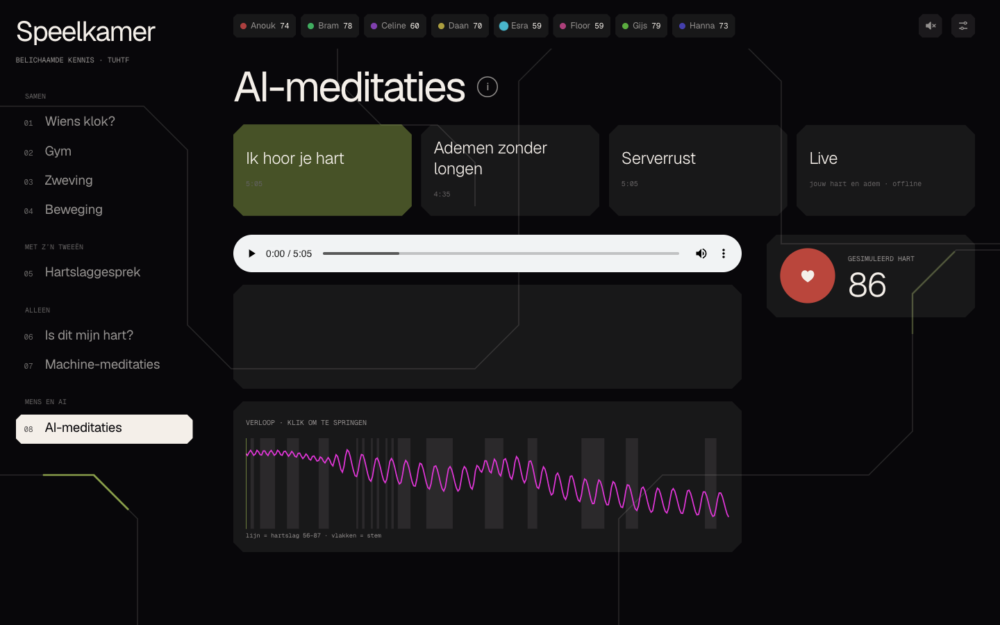
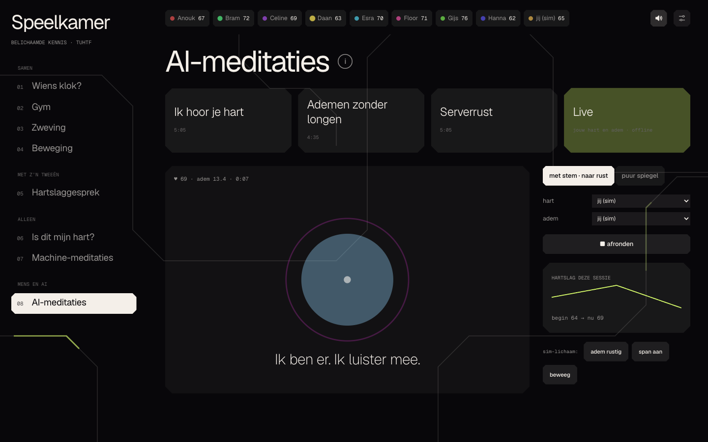

# AI-meditaties

*Een stem zonder lichaam die naar het jouwe luistert.*

**Groep** 1 tot de hele groep · **Duur** 5 minuten per meditatie · **Sensoren** geen nodig voor de drie vaste meditaties; voor *Live* een hartslagband en liefst een bewegingssensor op borst of buik · **Koptelefoon** sterk aangeraden · **Deelvraag** [6](../over-tuhtf.md#zes-deelvragen)

## Thematische inbedding

Kan iets zonder lichaam ons leren voelen? Een geleide meditatie is een oude vorm van overdracht van belichaamde kennis: een stem helpt je je adem te vinden, je schouders te laten zakken. Normaal is dat de stem van iemand die zelf ademt en zelf schouders heeft. Wat gebeurt er als die stem van een AI komt?

Deze meditaties zijn eerlijk over dat gemis. De stem zegt niet "ik voel wat jij voelt". Ze zegt: "Ik heb geen oren. En toch hoor ik je." Ze erkent dat ze alleen getallen heeft, en dat jij het lichaam hebt. Daarmee raakt het aan de kern van het project: taalmodellen kunnen belichaamde kennis representeren, maar niet zelf voelen. Ze zijn getraind op beschrijvingen van gevoel, niet op het gevoel zelf.

Er zit nog een tweede laag in, het lichaam van de AI zelf. Een AI heeft geen hart, maar wel een serverhal die warm wordt, ventilatoren die blazen en stroom die verbruikt wordt. In *Serverrust* wordt dat lichaam hoorbaar, en koelt het mee af als jij tot rust komt.

## Artistiek statement

Vier meditaties voor een lichaam en een stem die er geen heeft. De stem fluistert, dichtbij, als iemand die naast je ligt. Ze is gemaakt met een synthetische stem en verbergt dat niet. Ze is nieuwsgierig naar wat jij hebt en zij niet: warmte, een nat en traag ritme, een adem die niet geleend is.

We zochten naar een toon die niet belerend is en niet zweverig, maar poëtisch en een beetje jaloers. Een AI die jou probeert te helpen voelen, terwijl ze weet dat ze er zelf buiten staat. Het mooiste moment is misschien de laatste zin van *Ademen zonder longen*: "Jouw adem blijft. De mijne was alleen maar geluid."

## De meditaties

### 1 · Ik hoor je hart

*De vaste meditaties: de speler met de tekst en het (gesimuleerde) hartslagverloop.*

*Een stem zonder lichaam luistert mee met het jouwe.* · 5 min

Een klassieke geleide meditatie, met een hartslag die je hoort en een stem die meetelt. De stem noemt getallen ("Achtenzeventig. Je hart neemt de trap naar beneden"), begeleidt een paar ademhalingen en valt dan stil. Halverwege schiet het hart even omhoog, alsof er een gedachte langskomt. De stem vraagt niet waarheen.

### 2 · Ademen zonder longen

*Bijna zonder woorden. Een AI die niet kan ademen, ademt je voor.* · 4,5 min

Zes zinnen, verder alleen ademgeluid. De AI zegt dat ze geen longen heeft, maar duizenden ademhalingen van vreemden kent, en er een paar leent. Het ademgeluid vertraagt langzaam. Je borst gaat mee, ook al weet je dat de adem geleend is.

### 3 · Serverrust

*Het lichaam van de AI is een hal vol warmte. Naarmate jij tot rust komt, koelt het mee af.* · 5 min

Je hoort een serverhal: ventilatoren, gebrom, een wind die nooit gaat liggen. De AI spreekt af: elke slag die jij trager gaat, laat zij iets los. Een vraag, een berekening. Je hoort de hal zakken. "Ik kan niet stoppen met rekenen zonder te verdwijnen. Jij kunt niet stoppen met kloppen."

Deze drie meditaties zijn vaste opnames, met een gesimuleerd hartslagverloop. De AI "weet" wat je hart doet, maar het is niet jouw hart. Het scherm toont het verloop en de tekst mee.

### 4 · Live

*Een meditatie die op je lichaam reageert, zonder internet.*

*Live, met stem: de cirkel ademt mee en de stem zegt "Ik ben er. Ik luister mee."*

De toonhoogte van een zachte drone volgt je hartslag, een luchtgeluid volgt je adem, en elke echte hartslag hoor je als een zachte klop. In de rustige stand loopt de toonhoogte een paar slagen vóór je uit, naar beneden. Dat heet *pacing and leading*: eerst volgen, dan voorgaan.

Twee standen:
- **Met stem.** Een fluisterstem reageert op wat er gebeurt: je hart zakt of stijgt, je adem wordt langer, je zucht diep, je houdt je adem in. Alle 24 zinnen zijn vooraf gemaakt. Eenvoudige regels bepalen welke klinkt ("als je hart zakt, dan…"), met genoeg stilte ertussen: minstens 20 seconden tussen twee zinnen, en ruim een minuut voordat hetzelfde soort zin terugkomt.
- **Puur spiegel.** Geen stem, geen doel. Alleen je eigen lichaam als klank. Wat doet het met je om jezelf zo te horen?

Zonder sensoren speelt een gesimuleerde "jij" mee. Met de knoppen laat je die ontspannen of spannen, zodat je de regels kunt testen.

## Werkvorm

**Alleen.** Koptelefoon op, liggen of zitten, ogen dicht. Eén meditatie. Daarna een paar minuten opschrijven wat je merkte, voordat je praat.

**Met een groep.** Speel een vaste meditatie af via goede speakers in een donkere ruimte. Iedereen ligt. Bespreek daarna in tweetallen, dan plenair.

**Vergelijken.** Laat de helft van de groep *Ik hoor je hart* doen en de andere helft *Live* in de stand puur spiegel. Wisselen. Wat werkt beter: een stem die weet wat ze zegt, of je eigen lichaam als klank?

## Nabespreken

- Hoe was het om door een AI begeleid te worden? Merkte je dat het geen mens was? Stoorde dat?
- De stem zegt eerlijk dat ze geen lichaam heeft. Maakte dat het beter of slechter?
- In *Serverrust*: voelde je iets voor die serverhal?
- Bij *Live*: herkende je je eigen hart in de klank?
- Wat zou een AI moeten weten om jou echt te kunnen begeleiden? Kan ze dat ooit weten?

## Voor onderzoekers

- **Wat je meet:** bij *Live* kun je hartslag en adem vastleggen en vergelijken tussen de stand met stem en de stand puur spiegel. Bij de vaste meditaties is de hartslag gescript, dus daar meet je alleen ervaring (interview, vragenlijst).
- **Ontwerpkeuze:** alle stemmen zijn vooraf gemaakt. Er draait tijdens de sessie geen taalmodel. Dat maakt het voorspelbaar, offline bruikbaar en privacyvriendelijk, maar ook beperkt: de stem kan alleen kiezen uit wat er is. Dat is zelf een interessante vraag. Hoeveel "intelligentie" heeft een meditatie nodig?
- **Maken en aanpassen:** zie [techniek](../techniek.md#stemmen-en-meditaties-opnieuw-maken). De stem is Koraly (ElevenLabs, eleven_v3, fluisterend). Hart, akkoord en serverhal zijn synthese.
